# Stage_2 — Executive summary: the surface mesh

6 Nov 2026, updated 9 Nov 2026 · Michail Karalis · CFD_Automation, Stage 2 (repo karmix96/aeris, branch `stage2-surface-mesh`)

> **What changed since 3 Nov (updated 9 Nov).** Sections 4–8 hold the details.
>
> - **Built on 7 Nov**
>   - The new surface rules (decisions 71, 72, 74): levels VC, C, M, F with each target met at the level that needs it; the lighter band, tip gap and station gap; the lower band from the leading edge (option A, chosen by Mike on 7 Nov). The first approach is kept in `configs/surface_first.yaml`.
>   - In Stage 1: the nose fix (decision 64; the defect was real, the 6 Nov correction was wrong) and similarity (decision 70: every wing at unit mean chord; the sets rebuilt, 722 of 722).
>   - The new screen (study 9): 1,724 of 1,724 builds pass, at all four levels; F has 6.7 M cells median on the wing blocks (largest 10.2 M; an estimate; the C-H wake lines add a rough +30–60 %), below the 9–11 M asked.
>   - **8 Nov: the Re levels 10⁵, 3 × 10⁵, 10⁶, 4 × 10⁶** (decision 78). The 20 reference wings screened again at the new levels at VC, C, M and F: 320 of 320 pass, and the 160 rebuilt at 10⁵ and 3 × 10⁵ have the very same nodes as on 7 Nov. The refine map and its as-built check redone at the new levels (the same conclusions). The 2-D section tables extended to 1.5 × 10⁷.
>   - The refine map at the Re levels (study 11): the lower band holds every strip; the upper band as written (0–85 % c) misses the upper transition at low Re, but the built mesh has band-size cells there. Since 8 Nov the upper band is written 0–100 % c (Mike).
>   - The nose solved at every level, the strictest wins (Mike's answer, 7 Nov): first it was solved at VC and F only, and M needed a repair (nose × 0.9) on all 20 flying-wing reference builds (nose cell C/M 1.44, M/F 1.17 instead of 1.3). Now: 0 repairs on the reference builds, and the family rule is exact; 4 of 782 F builds of the full sets then needed one round (0.003–0.006° over the solve's tolerance). Since 8 Nov a repair belongs to the family (decision 80), and none is needed (study 12).
>   - **8 Nov: the family screen (study 12).** Every set at all four levels for the first time: 782 families (702 wings at Re 3 × 10⁵, and the 20 reference wings at the 4 Re levels) × VC, C, M, F = 3,128 builds; 3,128 pass, 0 crash. One nose factor per family at every level: 0 families needed a repair, so every wing keeps the 1.3 step between levels. Cells on the wing blocks, median (largest), in millions: VC 0.60 (1.02), C 1.26 (2.19), M 2.70 (4.69), F 5.91 (10.21); F on the reference wings 6.73 median. The upper band at 0–100 % c added 2 ring nodes on some meshes (VC 44 of 782, F 383 of 782), cells at most +1.1 %.
>   - **9 Nov: what the band costs (study 13), and the band stays on (decisions 81, 82).** A switch to build without the band was added and measured: the band nearly doubles the cells at Re ≥ 3 × 10⁵ (on ÷ off 1.79–1.91 at every level; 1.08–1.09 at 10⁵); largest F 10.21 M on, 5.60 M off. With the band off, all 20 BWB reference builds at M fail the tip cap (0.0495 against 0.05). Mike's decision: the band stays on for every run, SA and LM alike (one mesh for both solvers); the switch stays unused; no cap change; the surface rules are frozen: a question gets a measurement first, a rule changes only when a check fails or a solver result shows a problem.
> - **Decided (owner)**
>   - Transition must be captured, with ADflow and SU2 (4 Nov). The Mach range extends toward 0.5, with no supersonic flow (4 Nov). Angles of attack from −5° to post-stall, plus a separate post-stall study (6 Nov). One matched C-H volume mesh for ADflow and SU2 (6 Nov; Stage 3).
>   - 8 Nov: both builder choices confirmed (decision 77: the growth limits by the family rule; the station growth 1.2 with at least 12 gaps per panel at M); the upper band written 0–100 % c; a nose repair belongs to the family (decision 80: one factor on all four levels, every mesh labelled); the label rules get a tolerance at their thresholds (decision 79, Stage 1).
>   - 9 Nov: the band stays on for every run, SA and LM alike (decision 81; the switch to turn it off stays unused); the surface rules are frozen (decision 82).
>   - The Re levels 10⁵, 3 × 10⁵, 10⁶, 4 × 10⁶ (8 Nov; were 1.5 × 10⁶ and 3 × 10⁶): 4 × 10⁶ takes in every cruise point of the Greek tactical UAVs (LOTUS, Archytas, the RX series; ACTUS is the EDF project behind LOTUS and the Patroller), and 10⁶ fills the old ×5 gap (check C4 on 2-D data); 10⁵ stays 18 % below the slowest real UAV, as a margin (7 Nov).
> - **Pending**
>   - The solver split (ADflow SA for the mesh studies and the fully turbulent data; SU2 SST + LM on about 20 % of the wings), decided right before the runs, on the same meshes with the band on (decision 81), and the core Mach range (≤ 0.2 now, 0.3–0.5 later).
> - **Open**
>   - Close Stage 2 (Mike's word) and start Stage 3. Owed first: one pyGeo `build --all` on Mike's machine (new input
>     hashes after the label fix; the surfaces are the same). The pyGeo run is done (Mike's machine, 8 Nov): on the 20
>     reference wings the pyGeo loft gives the same meshes as the numpy one.

Stage 2 puts a structured surface mesh on every wing that Stage 1 makes. The **first approach** was built and screened on 2–3 Nov: 790 of 790 builds passed all 13 checks, on 730 wings of 4 types and 5 sets plus the 20 reference wings at all four Re levels. On 4–6 Nov a **new approach** was decided, and on **7 Nov it was built and screened**: 1,724 of 1,724 builds pass, on the rebuilt sets (unit mean chord, the true nose), at all four levels VC, C, M and F. On **8 Nov every set was meshed at every level** (study 12): 3,128 of 3,128 pass, with no nose repair. It keeps the mesher and changes where each rule is met, three rule values, the lower band, the volume mesh around the surface (Stage 3) and the wing size. This summary says what Stage 2 is, how one mesh is made, what the thirteen studies showed, what was first and what changed, what is weak, what is left, and what Stage 3 gets. Studies 1–7 are first-approach evidence, on the geometry of before 7 Nov; studies 8–13 are new. More detail on every figure: the page *Surface Mesh* (`docs/SURFACE_MESH.html`).

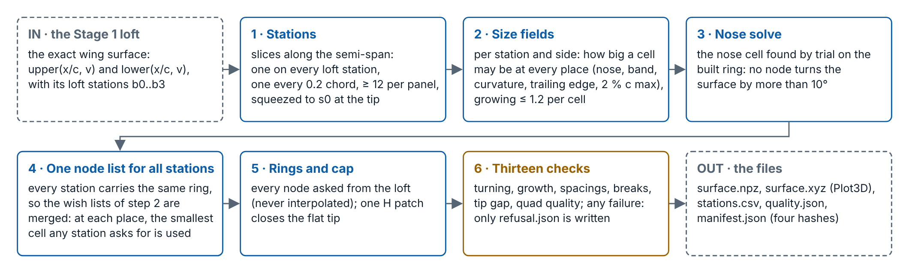

*What it shows.* The six steps every wing goes through: stations, size fields, the nose solve, one node list, rings and cap, 13 checks, then the files.

**Conclusion.** The same six steps run on every wing, in both approaches. No step knows the wing type: the rules read the loft, the chord and the local Re.

## 1. What Stage 2 is, and why a structured mesh

**What it is.** One wing surface in (the Stage 1 loft), one structured surface mesh out. At every spanwise station there is a closed ring of points around the section, the same ring at every station, from root to tip. One patch closes the flat tip (the *cap*). Every node is asked from the loft at its place; nothing is interpolated between stored sections. The volume mesh (the cells off the wall), the wake and the CGNS file are Stage 3.

**Name and files.** A mesh is named `mesh_<level>_<wing_hash8>_re<Re>` (for example `mesh_VC_…`), because two sizes depend on the Re: the tip gap and the band cell. Each mesh writes `surface.npz` (the arrays), `surface.xyz` (Plot3D, opens in ParaView), `stations.csv` (asked and delivered per station), `quality.json` (every check, and every rule value with its anchor level and reason) and `manifest.json` (hashes, and the rules file). A mesh that fails a check writes only `refusal.json`.

**Why structured.** A structured mesh is rows and columns of cells; every cell has an address (i, j, k).

- It lines the cells up with the boundary layer, so few cells resolve it.
- Every spacing can be divided by exactly 1.3 to make the next finer mesh. The grid-convergence method we use (Celik et al. 2008) needs that.
- Every node has an address (nose, trailing edge, tip), so errors can be mapped by region.
- The mesh is a set of numbers (spacings, counts, growth) that a rule can give. That is the paper's claim.

**What it costs.** One block layout per class of shape (box wings and winglets are out of scope). Every station carries the same ring, so the station that needs the most nodes sets the count for all. Quality follows the geometry: very swept, very thin panels make sheared cells.

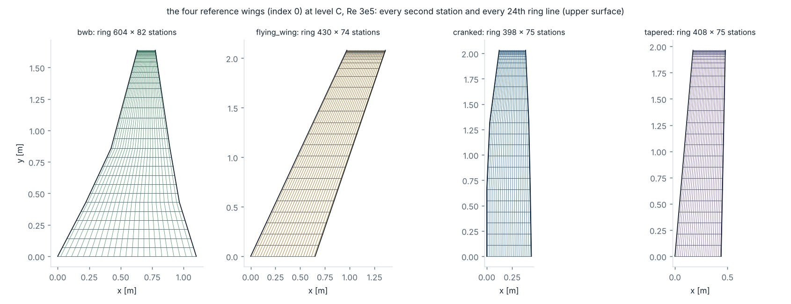

*What it shows.* First approach, on the geometry of before 7 Nov: the four reference wings (index 0) at level C and Re 3 × 10⁵ on the mean chord, every second station and every 24th ring line of the upper surface.

**Conclusion.** Same rules, same code, four shapes. The BWB gets the most ring nodes, because its root has the highest local Re and so the smallest band cell as a share of the chord. It also gets the most stations, because its tip is the smallest. Nothing was set by hand for any type.

## 2. How one mesh is made: the six steps

The steps are the same in both approaches; the numbers here are the first approach's (level C). The new values per level are in section 3.

1. **Stations (along the semi-span).** A station sits exactly on every loft station (root, both breaks, tip), because the loft has a crease there. Between them the gap is 0.2 × the local chord, at least 12 gaps per panel, and neighbouring gaps differ by at most 1.2. Toward the tip the gaps shrink to the tip's first wall cell s0 (y⁺ = 1 at the tip Re), so the cap meets a cell of the size it will get in the volume mesh. New: 0.25 × the local chord at M, and the last gap 2 × s0.
2. **Size field (around the section).** At every place along the section the cell may not be bigger than the smallest of: 2 % c; the band cell (bubble length / 20) inside the transition band (upper 0–85 % c, lower 60–100 % c, new: 0–100 % c); the curvature cap; the nose cell; 0.1 % c at the trailing edge. The cells then grow by at most 1.2 from one to the next.
3. **Nose solve.** The nose cell is found by trial on the ring as built: smaller and smaller, until no node bends the surface by more than 10°. New: each level has its own angle (16.9° at VC down to 7.69° at F); the nose is solved at every level, and the strictest spacing wins.
4. **One node list.** Every station's wish list is put on one scale (a fraction of the side's length), and at every place the smallest cell any station asks for is used, on every station and both sides. Cost: about 3 % more nodes.
5. **Rings and cap.** Upper trailing-edge corner → nose → lower corner → across the blunt base (8 cells at level C; 8, 10, 14, 18 at VC, C, M, F). One patch closes the tip, its edge equal to the tip ring node for node.
6. **Thirteen checks.** Turning, kinks, nose envelope, growth along the ring, band spacing, trailing-edge spacing, growth along the semi-span, loft stations hit, tip gap, every ring in its plane, wing-quad quality, cap-quad quality, ring count. Any failure: no mesh, only `refusal.json`. New: each level is checked against its own limits.

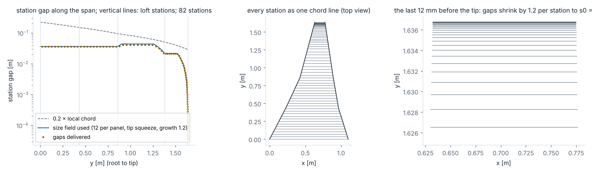

*What it shows.* First approach: the BWB reference wing, level C, Re 3 × 10⁵: the station gap along the semi-span (the 0.2 c target, the 12-per-panel floor, the tip squeeze, the growth limit) and the gaps delivered.

**Conclusion.** On this wing the 0.2 c gap rule hardly acts. The floor of 12 gaps per panel sets the stations on the inner panels, and the tip squeeze sets them on the outer panel: 43 gaps lie in the last few millimetres, shrinking from 3 cm to 36 µm. So the mesh study along the semi-span must test the floor and the squeeze first, then the gap value.

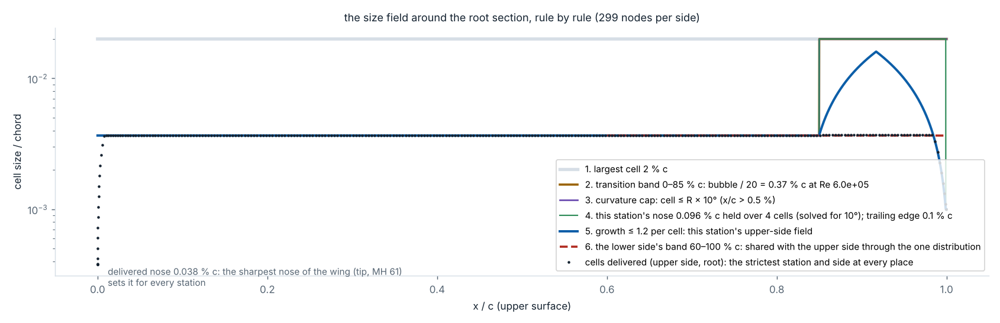

*What it shows.* First approach: the root section of the BWB reference wing, upper side. Each panel adds one rule: the 2 % c cap, the band, the curvature cap, the nose and trailing-edge cells, the growth limit, and the shared result.

**Conclusion.** On this wing the transition band sets almost every cell: the whole ring is at the band cell size, except at the nose and the trailing edge, where the cells are smaller. The nose cell is 0.04 % c, smaller than this station needs (0.096 % c), because one node list serves the whole wing and the sharpest nose (the tip's MH 61) sets it for every station. Together with the station figure: along the semi-span the 12-per-panel floor and the tip squeeze set the stations; around the section the band sets the cells. So the mesh size follows two rules, the band cell (set by the Re) and the panel floor, and the mesh studies must test these two first.

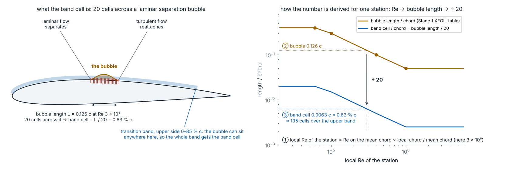

*What it shows.* Left: a laminar separation bubble with the 20 cells the rule puts across it, and the band where it may sit. Right: the three steps for one station (local Re → bubble length from the Stage 1 table → ÷ 20).

**Conclusion.** The band cell is one number per station and side, set by the local Re alone. The only free choice is the 20, which comes from one vendor guide (Ansys CFX, for the γ-Re_θ transition model). The bubble lengths are 2-D XFOIL values, so the rule is only as good as that table. New: the 20 is met at F (9.1 at VC), and the bubble length stops at 0.10 c from local Re 4 × 10⁵.

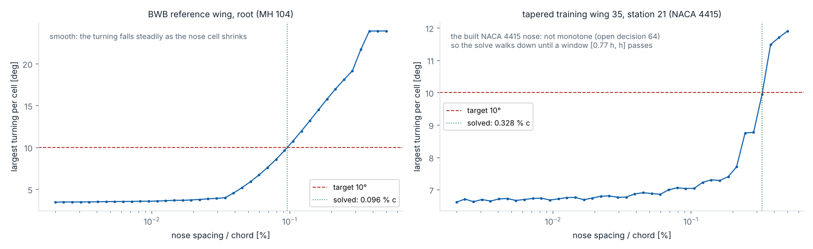

*What it shows.* First approach, on the old sections: turning per cell against the nose spacing, on rings built at 40 spacings. Left: the BWB root (MH 104). Right: a NACA 4415 station.

**Conclusion.** The search makes the nose cells smaller until no cell bends the surface by more than the limit (here 10°). On most sections this is simple: smaller cells always mean less bending (left), so one search finds the size (MH 104: 0.096 % c). On some cambered sections it is not (right, NACA 4415): below a nose cell of about 0.2 % c the bending stops falling and stays near 7°. The worst cell is then no longer at the nose but about 2 % c down the lower side, where the growth limit sets the cell size, so smaller nose cells cannot help there. The line also wiggles, because each new size shifts the nodes a little. A plain search could therefore stop on a size that passes only by luck. So the code also tests the sizes just below its answer, and checks the final mesh again. The small bump on the old NACA 4415 section was a separate defect, now fixed in Stage 1 (study 4); the true airfoil behaves the same way.

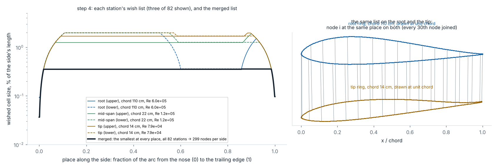

*What it shows.* Left: the wish lists of three stations (root, mid, tip) and the merged list. Right: the merged list applied to the root ring and the tip ring.

**Conclusion.** The merged list is the lowest of all wish lists: the root's band sets the middle, the tip's nose sets the front, every station's lower band sets the back. Node i lands at the same place on every station, which keeps the cells between stations clean.

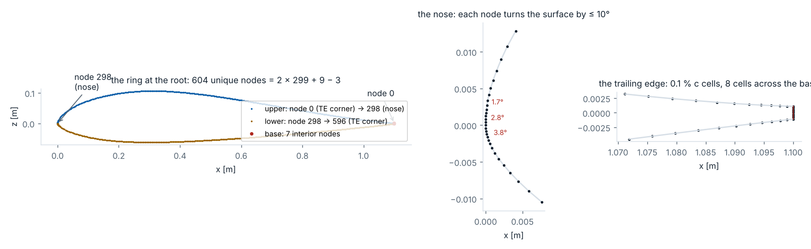

*What it shows.* The root ring of the BWB reference wing: the node order, the nose with the turning per node, and the trailing edge with its 0.1 % c cells and the 8 base cells.

**Conclusion.** One closed curve holds the nose, both sides and the base. So the leading edge is a spacing request, not a block size, and the base needs no block of its own. The nose nodes turn by 10° or less; the two trailing-edge corners turn by about 90° by design and are left out of the check.

## 3. The rules and their sources

"Law n" is the row of the laws table in the Grand Roadmap (primer, Annex G). The new values are built (7 Nov): `configs/surface.yaml`, read by `laws.py`, which moves each value from its anchor level by the family rule (÷ 1.3 per finer level for spacings and angles, × 1.3 for counts, g^(1/1.3) for growth).

| Where | First rule (level C, built 2–3 Nov) | Source | New (built 7 Nov): VC / C / M / F |
| --- | --- | --- | --- |
| Nose (law 1) | no node turns the surface by more than 10°, solved on the ring as built | Grand Roadmap starting value; S8 | 10° at M: 16.9 / 13 / 10 / 7.69°; solved at every level, the strictest spacing wins |
| Trailing edge (law 3) | 0.1 % c at the two corners | DPW gridding guidelines | 0.1 % c at M: 0.169 / 0.130 / 0.100 / 0.077 % c |
| Blunt base (law 6) | 8 cells at C (10, 14, 18 on the finer levels) | S8; our choice | 8 / 10 / 14 / 18 (≥ 8 at VC) |
| Transition band | upper 0–85 % c, lower 60–100 % c; cell = bubble length / 20; bubble 0.40, 0.30, 0.10, 0.05 c at local Re 6 × 10⁴, 10⁵, 4 × 10⁵, 10⁶ | Stage 1 handover; Ansys CFX guide (20 per bubble) | upper 0–100 % c (Mike, 8 Nov), lower 0–100 % c (74, A); on for every run (81); cell = bubble / 9.1 / 11.8 / 15.4 / 20; bubble 0.40, 0.30, 0.10, 0.10 c |
| Largest cell | 2 % c outside the bands | our choice | 2 % c at M: 3.38 / 2.60 / 2.00 / 1.54 % c |
| Growth along the ring | 1.2 built, 1.25 checked | Stage 1 handover; DPW | built 1.2 / 1.15 / 1.11 / 1.087; checked 1.25 / 1.19 / 1.14 / 1.107 |
| Stations (laws 8, 9) | one on every loft station; gap 0.2 × chord; ≥ 12 per panel; growth 1.2 (1.3 checked) | geometry; our starting values | gap 0.4225 / 0.325 / 0.25 / 0.192 × chord; ≥ 8 / 10 / 12 / 16 per panel; growth 1.2 at VC (checked 1.3 / 1.22 / 1.17 / 1.13) |
| Tip (laws 9, 10, 13) | last gap = s0, the first wall cell at y⁺ = 1 at the tip Re | Grand Roadmap; flat plate (White 2006) | last gap = 2 × s0; y⁺ 1 / 0.77 / 0.59 / 0.46 |
| Levels (law 23) | C, M, F, FF: every spacing ÷ 1.3 per level, growth g^(1/1.3) | Celik et al. 2008 (r ≥ 1.3) | VC, C, M, F: hard minimums at VC, accuracy targets at M, transition targets at F |

**What the band costs.** First approach: about 200 ring nodes at Re 10⁵, 400 at 3 × 10⁵, and 850 at and above 1.5 × 10⁶, against 150 in S8. New: 120–220–240 ring nodes at VC and 254–474–514 at F (study 9).

**The two Re-dependent sizes.** The first wall cell s0 is 0.032 % c at Re 6 × 10⁴, 0.0072 % c at 3 × 10⁵ and 0.0024 % c at 10⁶ (y⁺ = 1). The band cell at the first level C is 2.0 % c at Re 6 × 10⁴, 0.63 % c at 3 × 10⁵ and 0.25 % c at 10⁶ and above; new at F: 0.5 % c from local Re 4 × 10⁵ up.

## 4. The studies, with their conclusions

None of them is a flow result: no solver has run on these surfaces. Studies 1–7 are first-approach evidence, on the geometry of before 7 Nov (real size, the old nose rule, the old 20 reference wings, 13 of which were replaced on 7 Nov). Studies 8–13 are new.

**Study 1 · The robustness screen (first approach).** Every built wing of every type and set was meshed at level C and Re 3 × 10⁵, and the 20 reference wings at all four Re levels, with the numpy twin of the loft. The pass and fail limits were written before the run. Result: 790 builds, 790 passed, 0 refused, 0 crashed. The largest delivered turning was 10.02°, the largest growth 1.21 (limit 1.25), and 32 builds needed a nose repair. The lowest wing-quad quality was 0.09, on corner wings with an 85°-swept first panel. Build time: median 5.0 s, max 8.1 s.

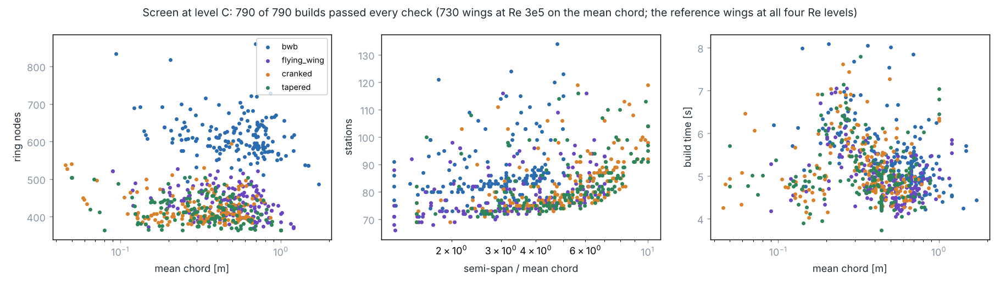

*What it shows.* Every build of the first screen: ring nodes against the mean chord, stations against the semi-span over the mean chord, and the build time, per type.

**Conclusion.** The ring size is set by the local Re of the largest chord, not by the wing's size: about 600 nodes on the BWB, about 400 on the other three types. The station count rises with the aspect ratio, from about 70 to 130. Every wing takes 4–8 s, so the mesher is not the slow part of the workflow. With 0 failures in 790 builds, the true failure rate is below about 0.4 % with 95 % confidence (rule of three), for the surface alone and the first rules.

**Study 2 · The family ratios (first approach).** Levels C, M and F of the four reference wings; every spacing measured between levels.

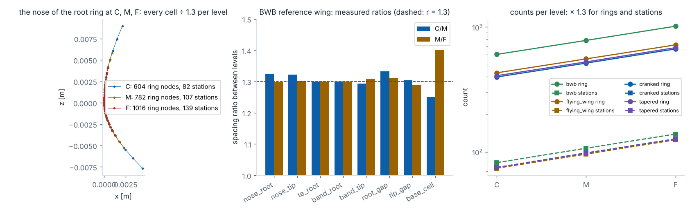

*What it shows.* Left: the BWB root nose at C, M, F. Middle: the measured ratio of every spacing between levels. Right: ring nodes and stations per level, all four types.

**Conclusion.** Each finer level is the same mesh made 1.3 × finer everywhere: every spacing shrinks by 1.30 (within 3 %), and the node and station counts grow by 1.3. That is what the error estimate (GCI) needs. Only whole-number counts cannot step by exactly 1.3: the base cells (8, 10, 14, 18) and the gaps of the first panel. The growth ratio must shrink too (g^(1/1.3)); otherwise only the cells next to the fine spots would refine. The new rules do the same on all four levels (study 9).

**Study 3 · One node list per station, or one for the wing (first approach).** The worst wing of the first screen (scaled Jacobian 0.08) was rebuilt both ways.

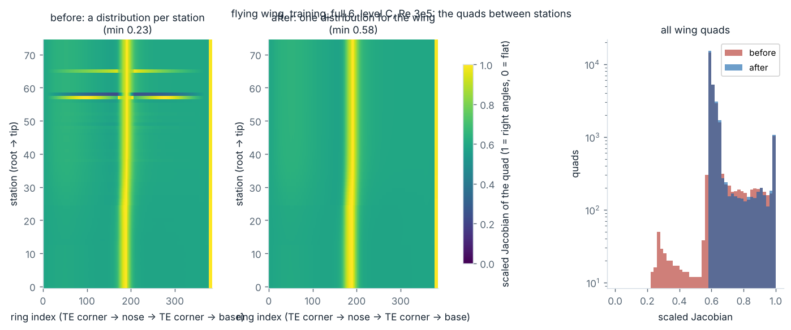

*What it shows.* A flying wing (training_full 6), level C: the quality of every wing quad (1 = right angles, 0 = flat) with per-station lists and with one list, and the histogram.

**Conclusion.** If each station places its nodes on its own, node i sits at a slightly different place on neighbouring stations, and the cells between them shear (quality 0.08 here; 1 is a perfect rectangle). With one node list for the whole wing, node i sits at the same place on every station: the worst quality rises to 0.58 on this wing, and from 0.77 to 0.92 on the BWB reference wing. It costs about 3 % more nodes around each section. Chosen as decision 60.

**Study 4 · The nose of the built sections.** While solving the nose, the turning did not fall steadily on NACA 4415. So the nose radius of the raw airfoil files was compared with the built sections.

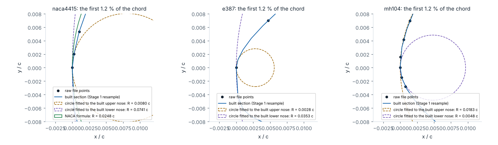

*What it shows.* First approach, the old sections: the first 1.2 % of the chord of NACA 4415, E387 and MH 104: the raw file points, the built section, circles fitted to the built upper and lower nose, and the formula's circle for NACA 4415.

**First reading (2 Nov).** The built nose looked lopsided: on NACA 4415, 0.008 c on the upper side and 0.074 c on the lower side, against one radius of 0.0248 c by formula. On cambered sections the two sides differed by 3–13 ×. The likely cause named then: the leading edge is taken at the raw point farthest from the trailing edge, not at the nose apex.

**Correction (6 Nov), withdrawn on 7 Nov: it was wrong.** It said: with the same one-sided formula the raw files show nearly the same split (NACA 4415 raw 0.0081 / 0.0736 c against built 0.0080 / 0.0741 c), so the split is mostly how a one-sided formula sees a tilted nose. But it compared built and raw only at the raw points, where they agree by construction; the defect sat between them.

**Second correction (7 Nov): the defect is real; fixed in Stage 1.** Stage 1 measured raw and built with one curvature method that no frame or formula can fool (each curve a smooth spline, its curvature from its own derivatives along its own arc), and the largest turning a cell of 0.04–0.50 % c gets near the nose, against a 5 % test written before the run.

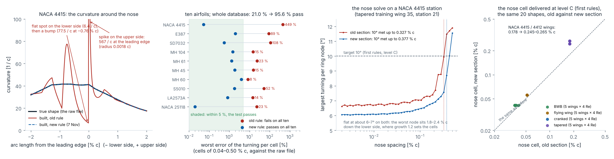

*What it shows.* Left: the curvature around the NACA 4415 nose: the true shape, the old built section and the new one. Second: the worst error of the turning per cell on the ten airfoils, old rule against new, against the 5 % test. Third: the Stage 2 nose solve on a NACA 4415 station, old section against new. Right: the nose cell the mesher delivers at level C (first rules) on the same 20 shapes at unit mean chord, old section against new.

**Conclusion.** The defect was real. The old rule put the leading edge on the file point farthest from the trailing edge and made the surface square to the chord there, but the real tip of the curve lies between two file points. So the built nose got a sharp spot on one side and a flat spot on the other: on NACA 4415 a 0.18 % c cell bent 9.47° where the true shape bends 4.31° (+121 %; +449 % for a 0.04 % c cell), and the old rule failed the 5 % test on all ten airfoils. The new rule (one smooth spline, the leading edge at its real tip, 201 points per side) passes on all ten (worst −3.9 %, MH 60) and on 95.6 % of the database (21.0 % before); a gate refuses 14 files whose nose folds back (none is used). Mike chose the fix on 7 Nov (decision 64); it is built and the sets were rebuilt. For the mesh: at the same 10° the NACA 4415 / 4412 reference wings now get a nose cell of 0.245–0.265 % c instead of 0.178 % c, so fewer nose nodes; the MH wings change little (0.036–0.052 → 0.041–0.056 % c). The flat part of the nose search stays (it comes from the growth limit, and the true airfoil does it too: 6.0–6.8°), so the double-check of the search stays.

**Study 5 · The corner set: where the rules stop (first approach).** The first screen crashed on the smallest BWB corner wing (12 mm tip chord).

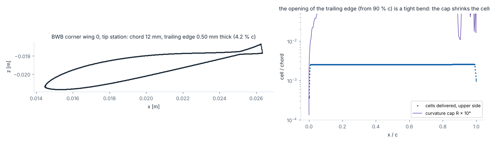

*What it shows.* The 12 mm tip section: the 0.5 mm trailing-edge floor is 4 % of this chord, so the section opens out over its last 10 % c, and each surface turns by 11–13° within 4 % of the chord.

**Conclusion.** On this tiny tip the 0.5 mm trailing-edge minimum was 4 % of the chord, so the section bent sharply over its last 10 %. A 2 % c cell across that bend already turns about 10°, so making the nose finer could never bring the worst bend under 10°, and the mesher crashed. The fix: the bend limit now acts along the whole section (from the local curvature), not only at the nose. The corner set did its job: it found a wing where a rule broke, and the rule was widened. Under similarity the trailing edge is 0.2 % c on every wing, so this bend no longer exists.

**Study 6 · Four passes of the screen (first approach).** Pass 1 refused or crashed 10 of 790 (tip-gap tolerance, the corner-wing bend, a break 0.9 mm from the root, sheared quads). Pass 2 refused 17 (growth 1.25–1.26 at NACA 4415 noses, now allowed within 1 %). Passes 3 and 4 refused none; pass 3 also found the nose cell held over one cell instead of four.

**Conclusion.** The screen was run four times while the code was being fixed: 10 failures in pass 1, 17 in pass 2, none in passes 3 and 4. Only the fourth run, on the final code, counts as the result; the first three show how the bugs were found. Every failure came from the corner and full-space sets (the extreme wings), as Stage 0 expected, never from the focus wings.

**Study 7 · The refine map: where to refine, per wing.** The Stage 1 flow dataset was read for each of the 20 reference wings (2-D XFOIL strips along the semi-span): where the flow turns turbulent, where the bubbles sit, where it separates, on both surfaces. The envelope over the conditions one mesh serves (Mach 0.03–0.13, −5° to 8° since 7 Nov; 0–8° before), plus a 10 % c margin, is the band that wing would need.

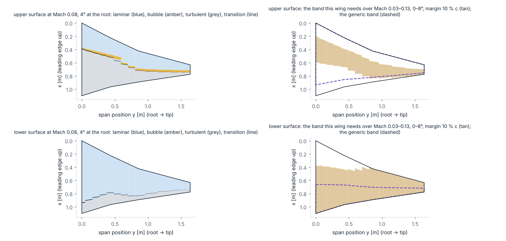

*What it shows.* The BWB reference wing from above (the old reference wing, at real size). Left: both surfaces at Mach 0.08 and 4° (laminar, bubble, turbulent, transition point). Right: the band this wing needs over −5° to 8°, against the first generic band.

**Conclusion.** The per-wing band is not smaller than the generic one; it sits elsewhere, and from −5° it is wider. Over −5° to 8° its cost is +8 % to +46 % of the generic band's (median +34 %); over 0–8° (first data, 3 Nov) it was −15 % to +20 % (median about +5 %). The first generic band missed the upper laminar flow beyond 85 % c at low angle outboard (by 10.5–15 % c), and the lower-surface transition near the leading edge: over −5° to 8° by the full 60 % c on all 20 wings. The new lower band (0–100 % c) covers that at no cost (study 8). The shortest root bubbles (1.4–10.7 % c) are shorter than the table assumes (5–14 % c) on all 20 wings. It is 2-D and calm air, on the old reference wings at real size, so it is a candidate (decision 65), not a rule, until a 3-D transition check.

**Study 8 · The band count for negative angles (decision 74, 7 Nov, before the build).** New data, with the planned rules of the new approach at VC read from a plan file, on the old reference wings. The refine map run down to −5° was read for the lower side. Then the 20 reference wings × 4 Re levels were built at VC twice: with the lower band of option B (60–100 % c) and of option A (0–100 % c), 160 builds.

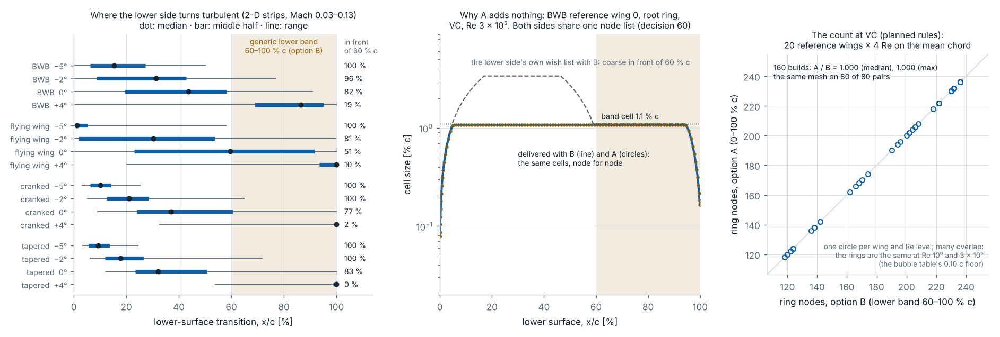

*What it shows.* Left: where the lower side turns turbulent, per wing type and root angle (2-D strips with an answer, Mach 0.03–0.13), against the first lower band. Middle: the cells along the lower side of the BWB root ring at VC, Re 3 × 10⁵, with B and with A, and the lower side's own wish list with B. Right: ring nodes with A against ring nodes with B, all 80 pairs.

**Conclusion.** At −5° the lower side becomes the suction side and turns turbulent near the nose (median 1–15 % c per type), in front of the first lower band (60–100 % c) on every strip with an answer; even at 0° on 51–83 % of the strips. Option A (lower band 0–100 % c) covers this; option B (keep 60–100 % c and run transition only from 0° up) does not. Yet A costs no cells: A and B gave the same mesh, node for node, on all 80 pairs (ratio 1.000), because both sides share one node list and the upper band already makes the front part fine. So Mike chose A on 7 Nov, and it is built: transition runs can start at −5°, at no mesh cost.

**Study 9 · The new screen: the built rules on every wing (7 Nov; the reference wings again on 8 Nov at the new Re levels).** The rules built on 7 Nov, on the rebuilt sets (unit mean chord, the nose fix; 722 wings), numpy loft. Every set at VC and at F (all sets at Re 3 × 10⁵, the 20 reference wings at all four Re levels: 782 builds per level), and the 20 reference wings at C and M (80 builds each). On 8 Nov the reference wings were built again at the new levels (10⁵, 3 × 10⁵, 10⁶, 4 × 10⁶); the 160 builds at 10⁵ and 3 × 10⁵ came out node for node the same as on 7 Nov, so the 7 Nov set builds stand. The nose is solved at every level. Each level refuses at its own limits. Per build: every check's value, limit and margin, ring nodes, stations, quads, time, which solve set the nose, and the reasons. The cells of the wing blocks are estimated (the count the pages use, because it can be redone): n = the largest over the stations of ceil(ln(1 + (g − 1) D / s0) / ln g) wall layers, cells = (ring nodes − 1)(stations − 1) n + cap quads × n, with g the level's wall growth (1.25 at VC to 1.107 at F), s0 the level's first wall cell at the local Re and D = 2 local chords.

| Level | Builds | Passed | Ring nodes | Stations | Cells [M], 20 reference wings × 4 Re: median (max) |
| --- | --- | --- | --- | --- | --- |
| VC (every set) | 782 | 782 | 120–220–240 | 51–63–84 | 0.68 (1.02) |
| C (reference wings) | 80 | 80 | 154–284–306 | 66–82–104 | 1.46 (2.19) |
| M (reference wings) | 80 | 80 | 198–366–396 | 82–104–133 | 3.07 (4.69) |
| F (every set) | 782 | 782 | 254–474–514 | 106–131–177 | 6.70 (10.17) |

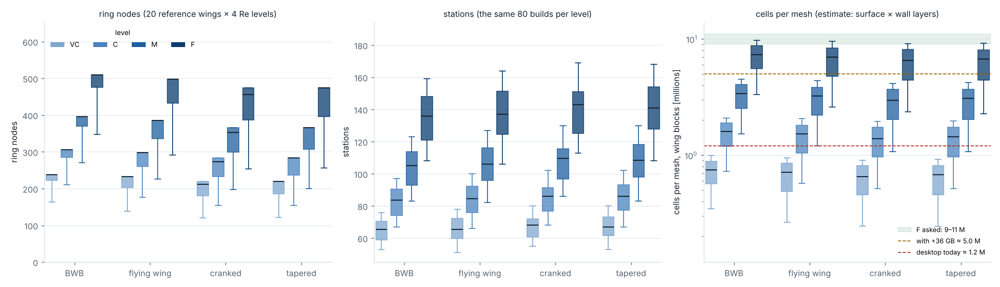

*What it shows.* The 20 reference wings × 4 Re at VC, C, M and F, per wing type: ring nodes, stations, and the cells of the wing blocks (log scale) against the 9–11 M asked for F, the desktop today and with +36 GB.

**Conclusion.** Each finer level has about 1.3 × more nodes around the section and 1.3 × more stations, so about 2.1 × more cells (measured 2.12–2.17; 1.3 × 1.3 × 1.3 = 2.2 with the wall layers). The BWB needs the most nodes around its sections. From Re 10⁶ up the node count stops growing, because the band cell stops shrinking there (the bubble length is held at 0.10 c from local Re 4 × 10⁵ up).

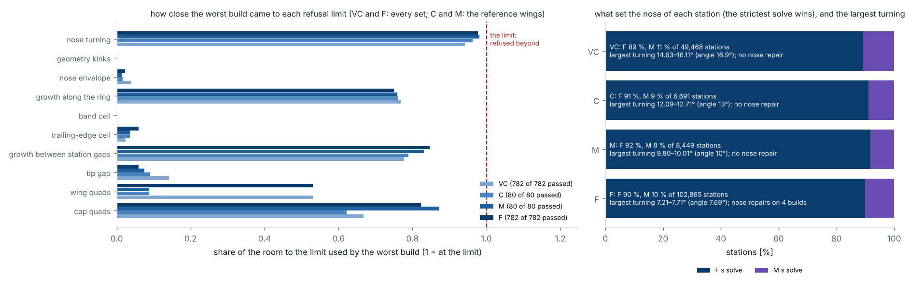

*What it shows.* Left: for every check, how much of the room to its limit the worst build used (1 = at the limit). Right: which solve set the nose of the stations, and the largest turning delivered per level.

**Conclusion.** No build crossed a limit. The check that comes closest is the quality of the tip cap: worst 0.075 at VC, 0.057 at M and 0.061 at F, against the limit 0.05. The nose size was set by F's limit on 89.8 % of the 167,399 stations and by M's on 10.2 %, never by VC's or C's. So the coarse levels get a finer nose than their own limit asks (the worst bend at VC is 14.6–16.1°, under its 16.9°), and F sits at its limit (7.21–7.71° for 7.69°; the check allows +0.2°).

**The nose at every level (Mike's answer, 7 Nov).** Each level has its own bend limit (16.9° at VC down to 7.69° at F). The first build found the nose size for VC and F only and made M from F's size × 1.3. On the 20 flying-wing reference builds that M nose bent just past its limit (10.02° allowed), so M needed a repair (nose × 0.9), which broke the exact 1.3 step between levels. Now the nose size is found for every level, each answer is put on one scale (× 1.3 per level step), the smallest wins, and every level is made from it by exact steps of 1.3: every level meets its own limit and the step stays exact. Against the first build: 80 of 320 reference builds changed, all of them flying wings (the BWB, cranked and tapered builds are the same node for node); nodes around the section changed by 0 at VC and F, 0 to +2 at C, −2 to 0 at M; repairs 20 → 0.

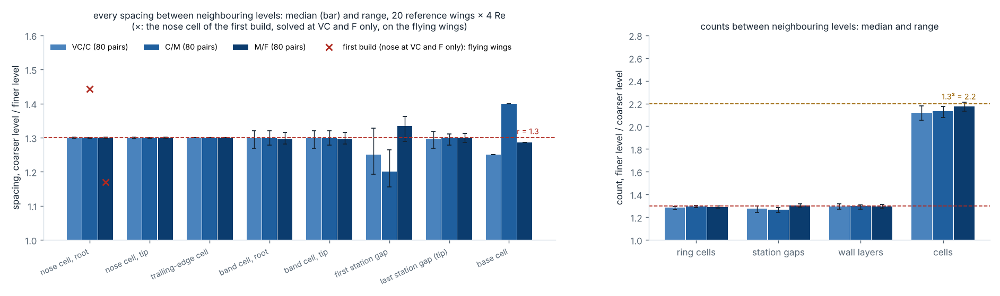

*What it shows.* Left: every spacing between neighbouring levels, coarser / finer, median and range over the 80 pairs of each step; red ×: the flying wings' nose cell in the first build (nose at VC and F only). Right: the counts (ring cells, station gaps, wall layers, cells), finer / coarser.

**Conclusion.** The levels are true scaled copies: the nose, trailing-edge, band and tip-gap cells refine by 1.269–1.321 per step. In the first build (nose at VC and F only) the flying wings' nose cell stepped by 1.44 (C/M) and 1.17 (M/F); solving the nose at every level fixed that. The other exceptions are whole numbers: the base cells (1.25, 1.4, 1.29) and the first station gap where the gaps per panel set it (1.25, 1.2, 1.33). The cells grow by 2.12, 2.13, 2.17 per step (median), close to 1.3³ = 2.2.

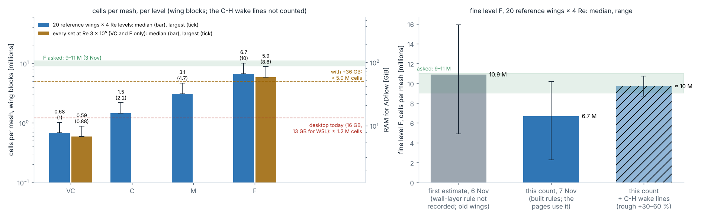

*What it shows.* Left: cells per mesh per level (this count), median and largest, with the RAM ADflow needs (1.51 GiB + 9.46 GiB per million cells). Right: the fine level F: the first estimate (6 Nov, rule not recorded), this count, and this count with a rough +30–60 % for the C-H wake lines.

**Conclusion.** The built rules mesh every wing: 1,724 of 1,724 builds passed, 0 crashed; build time median 4.3 s at VC and 8.9 s at F. F has 6.7 M cells median (2.3–10.2 M), below the 9–11 M asked. The largest F mesh grew from 9.7 M to 10.2 M with the 4 × 10⁶ level (BWB reference wing 3: 3 more wall layers and 3 more stations), 1.7 % above 10 M.

| Cells around the wing (wing blocks) | First estimate (6 Nov) | This count (7 Nov; used on the pages) |
| --- | --- | --- |
| How the wall layers were counted | not written down (only: about 1.30 × more layers per level) | from the first wall cell (y⁺ = 1 at each station's Re) out to 2 chords, each layer 1.25 × the one below at VC (1.187, 1.141, 1.107 at C, M, F) |
| Which wings | the old reference wings (before 7 Nov), planned surfaces | the rebuilt reference wings (13 of 20 new), built surfaces |
| Cells at F, median | 10.9 M (15.2 M with the first planned rules) | 6.7 M (2.3–10.2 M; 6.9 M and 2.3–9.7 M at the levels until 8 Nov) |
| Can we check and redo it? | no | yes |

In short: the pages use the 7 Nov count because we can check and redo it. The two counts differ because of how the wall layers were counted and which wings were used, not because of the surfaces (the built ones even have about 17 % more stations). Both count only the cells around the wing; the C-H wake lines (Stage 3) add a rough +30–60 %, so F lands at about 9–11 M. Stage 3 sets the real wall-layer rule. Memory: the desktop today (16 GB, about 1.2 M cells) runs every VC mesh; with +36 GB (about 5.0 M cells) it also runs every C and M mesh (cells around the wing only); F needs the HPC.

**Study 10 · The similarity check (7 Nov).** The 20 reference shapes of before similarity were built again at unit mean chord and meshed with the first rules at level C at the four Re levels: with the code of the similarity merge (the new size and trailing edge, the old nose) and with today's code (also the nose fix), against their first meshes at real size.

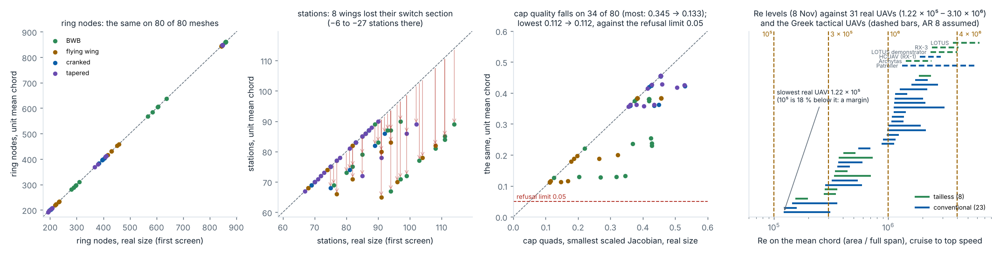

*What it shows.* The 80 meshes at real size against unit mean chord: ring nodes, stations (arrows: the wings that lost their switch section), the cap quality; and the four Re levels against the Re range of the real UAVs that set the Stage 1 ranges.

**Conclusion.** Similarity does not hurt the mesh. The same shapes at unit mean chord get the same nodes around every section on 80 of 80 meshes. The station count drops by 6–27 on the 8 wings that had a switch section (an extra station the old millimetre trailing-edge rule needed); it is no longer needed. One thing gets worse: the tip cap quality falls on 34 of 80 meshes (most: 0.345 → 0.133, BWB 1 at Re 10⁵). The old rule (at least 0.5 mm) had given small tips a thick trailing edge; now every trailing edge is 0.2 % c, which is thin on a small tip, so the cap cells next to it get flatter. The lowest stays 0.112, above the limit 0.05. The nose fix on top changes the rings by −4 to 0 nodes. The four Re levels cover the real UAVs (1.22 × 10⁵ to 3.10 × 10⁶); 10⁵ is 18 % below the slowest, kept as a margin (Mike, 7 Nov); since 8 Nov the top level, 4 × 10⁶, also takes in every cruise point of the Greek tactical UAVs (dashed bars; AR 8 assumed).

**Study 11 · The refine map at the Re levels (7 Nov; redone 8 Nov at the new levels).** The refine map of study 7 in its new Re mode: the 20 new reference wings at the four Re levels on the mean chord, root angles −5° to 12°, unit mean chord, the section tables rebuilt on the fixed nose. Per strip and side: where transition sits from −5° to 8°, the band it needs, and whether the bands hold it. Details: the refine page (`docs/REFINE_MAP.html`, first section) and `decisions/refine_map_re.md`.

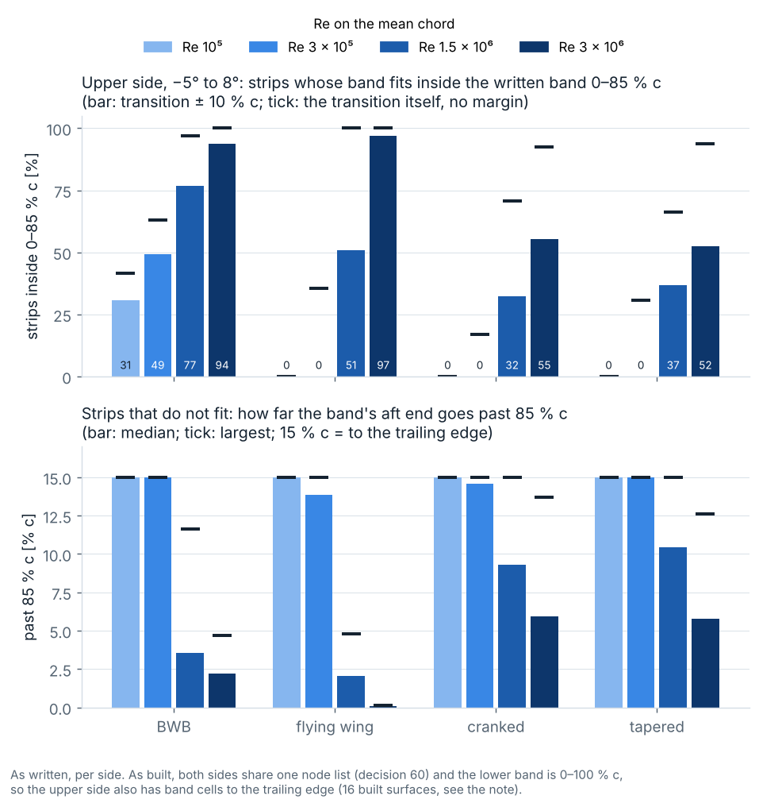

*What it shows.* Per type and Re level, −5° to 8°: the share of strips whose band fits inside the upper band as written until 8 Nov, 0–85 % c (bars), the share whose transition itself fits (ticks), and how far the band's aft end goes past 85 % c.

**Conclusion.** The lower band (0–100 % c) holds every strip: on every strip of every wing, at every Re level and angle from −5° to 8°, the lower transition (± 10 % c) falls inside the part of the chord where the mesh is fine. The upper band as written (0–85 % c) does not: at 10⁵ and 3 × 10⁵ the upper transition sits further aft on most strips (only 0–49 % fit; short by up to 15 % c, up to the trailing edge), and at 10⁶ and 4 × 10⁶ on 0–88 % of the strips (7 Nov, at 1.5 × 10⁶ and 3 × 10⁶: 3–68 %). As built this is no gap: because both sides share one node list and the lower band reaches 100 % c, the upper side also gets band-size cells to the trailing edge (0.950–0.995 × the band cell on 16 surfaces at VC). Written 0–100 % c, the mesh is the same at VC (to round-off; redone on 8 Nov at the new levels: 16 of 16 surfaces) but has 2 more ring nodes at F on 42 of 80 reference builds (+0.39 % cells; 7 Nov, at the levels of that day). Mike chose 0–100 % c on 8 Nov; study 12 counts what it changed on every set. Only the tailless wings lose XFOIL answers in numbers, at negative root angles (up to 46 % of the BWB strips at −5°).

**Study 12 · The family screen (8 Nov).** Mike's two choices of 8 Nov, built: a nose repair belongs to the family (decision 80: a round only where a ring turns past its level's check limit, the angle + 0.2°, and then one factor on all four levels of that wing and Re; every mesh labelled), and the upper band written 0–100 % c. Then every set at all four levels for the first time: the 702 wings of training_focus, training_full, corner1 and corner2 at Re 3 × 10⁵, and the 20 reference wings at the four Re levels: 782 families × 4 levels = 3,128 builds, numpy loft, two processes (about 2.9 h each). Code: `scripts/screen.py --family` (`cfdauto.mesh.surface.build_family`), `scripts/screen_study.py --family`; data: `data/studies/screen_family_*.json`.

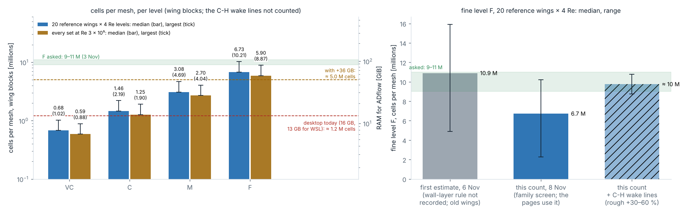

*What it shows.* Cells per mesh per level (wing blocks; the estimate of study 9), median (bar) and largest (tick): the 20 reference wings × 4 Re (blue) and every set at Re 3 × 10⁵ (amber), with the RAM ADflow needs. Right: F on the reference wings against the first estimate of 6 Nov, and with a rough +30–60 % for the C-H wake lines.

**Conclusion.** The rules mesh every wing at every level: 3,128 of 3,128 builds pass, 0 crash, so the failure rate per level is below about 0.38 % (rule of three, 95 % confidence), for the surface alone. No family needed a nose repair: the largest turning stays inside every check limit (VC 16.11°, C 12.77°, M 10.02°, F 7.72°, against 17.1°, 13.2°, 10.2°, 7.89°), so every wing keeps the 1.3 step at every level. Over all 782 families the asked nose spacing refines by exactly 1.3 per step; the delivered nose and trailing-edge cells by 1.295–1.304; the band and tip-gap cells by 1.269–1.326 (whole cells per band and gap); the cells by 2.12, 2.13 and 2.18 per step (median). Against the screens it replaces, the upper band at 0–100 % c added 2 ring nodes on VC 44 of 782, C 3 of 80, M 24 of 80 and F 383 of 782 meshes (cells at most +1.1 %); 3 F meshes have 2 fewer: 3 of the 4 builds that had a nose repair before. Cells, median (largest), in millions: VC 0.60 (1.02), C 1.26 (2.19), M 2.70 (4.69), F 5.91 (10.21); the largest is the BWB reference wing 3 at 4 × 10⁶ (10.17 M before the band change). The desktop today takes every VC mesh and 264 of 782 C meshes; with +36 GB every C and M mesh and 75 of 782 F meshes; F needs the HPC. The cap quads stay the closest to a limit: lowest 0.075 at VC, 0.080 at C, 0.057 at M, 0.061 at F (limit 0.05).

**Study 13 · The band option (9 Nov).** Mike made the transition band an option (decision 81): on for runs with a transition model (SU2 SST + LM), off for fully turbulent runs (ADflow SA), chosen right before the runs with the solver. Off: no band windows, the largest-cell rule only; every other rule the same. Built: `chord.transition_band` in `configs/surface.yaml`, `--band on|off`; the mesh name ends in `_noband`; the band-on meshes are unchanged. Then the 20 reference wings × 4 Re × VC, C, M, F with the band off, against study 12. Code: `scripts/screen.py --family --sets reference --band off`, `scripts/band_option.py`; data: `data/studies/band_option.json`.

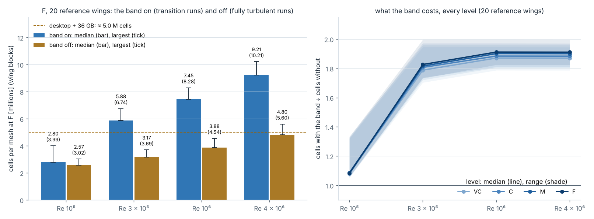

*What it shows.* Left: cells per mesh at F with the band on (blue) and off (amber), median (bar) and largest (tick), per Re level. Right: cells with the band ÷ cells without, per level (median line, range shaded).

**Conclusion.** The band nearly doubles the cells from Re 3 × 10⁵ up: on ÷ off is 1.79–1.83 at 3 × 10⁵ and 1.87–1.91 at 10⁶ and 4 × 10⁶ (every level); at 10⁵ it costs almost nothing (1.08–1.09), because the band cell there is about the largest cell. The largest F mesh is 10.21 M on and 5.60 M off. With the band off, 78 of 80 C meshes fit the desktop today (28 with it) and 72 of 80 F meshes fit with +36 GB (21 with it). The family rule holds with the band off (the nose cell × 1.299–1.300 per step). **Negative finding:** with the band off, all 20 BWB reference builds at M fail the tip cap (scaled Jacobian 0.0495 against the limit 0.05; 0.057–0.077 with the band on); more smoothing does not help, so the band-off option would need a cap fix first. 300 of 320 builds pass. **Decided (Mike, 9 Nov): the band stays on for every run**, SA and LM alike; the switch stays unused; no cap change; the surface rules are frozen (decision 82).

## 5. What was first, and what changed with the new approach

Everything in sections 2 and studies 1–7 is first-approach evidence: it shows the mesher works. The new approach was built on 7 Nov and has its own screen (study 9).

| What | First (built 2–3 Nov) | New approach | Status |
| --- | --- | --- | --- |
| Levels | C, M, F, FF; every rule met at C, the coarsest | VC, C, M, F. Hard minimums at VC (y⁺ ≤ 1, growth ≤ 1.25, base ≥ 8, no kinks, tip gap); accuracy targets at M (nose 10°, trailing edge 0.1 % c, station gap, largest cell); transition targets at F (20 cells per bubble; wall growth 1.107, just above the 1.1 a transition model asks for). VC on the desktop; C, M, F on the university HPC | built 7 Nov; screened (studies 9, 12); the nose solved at every level (7 Nov); both builder choices confirmed (Mike, 8 Nov) |
| Band cell | bubble length / 20 at C | bubble length / 20 at F; the bubble length stops at 0.10 c from local Re 4 × 10⁵ (0.5 % c at F) | built 7 Nov |
| Stations, tip | gap 0.2 × chord at C; last gap = s0 | gap 0.25 × chord at M; last gap = 2 × s0; station growth 1.2 kept (+17 % stations against the plan file) | built 7 Nov |
| Lower band | 60–100 % c, for 0–8° | 0–100 % c (option A, Mike, 7 Nov); costs no cells (study 8) | built 7 Nov |
| Upper band | 0–85 % c | 0–100 % c (Mike, 8 Nov): the built mesh already had band-size cells there; 2 more ring nodes on some meshes, cells at most +1.1 % (study 12) | built 8 Nov |
| Nose repair | one round at the level that needed it (it broke the 1.3 step there) | a round only past the level's check limit, then one factor on all four levels; every mesh labelled (decision 80) | built 8 Nov; 0 of 782 families needed one (study 12) |
| Re levels | 10⁵, 3 × 10⁵, 1.5 × 10⁶, 3 × 10⁶ | 10⁵, 3 × 10⁵, 10⁶, 4 × 10⁶ (Mike, 8 Nov; decision 78): the Greek tactical UAVs in cruise; check C4 on 2-D data; same 8,000 solves | screened 8 Nov (study 9) |
| Volume mesh | O-H body mesh + overset wake box and tip-vortex tube (ADflow only) | one matched C-H mesh for ADflow and SU2; wake lines to the far field; tip vortex in the outboard blocks | decided; Stage 3 |
| Wing size | real size; trailing edge max(0.5 / 1.0 mm, 0.2 % c) | unit mean chord (area / full span); Re an input (4 levels); Mach 0.1 + Prandtl–Glauert; trailing edge 0.2 % c; root chord out (18 → 17) | built in Stage 1 7 Nov; sets rebuilt; study 10 |
| Flow, angles, Mach | ADflow SA; 0–8°; Mach 0.03–0.20 | transition with ADflow and SU2; −5° to post-stall; toward Mach 0.5, no supersonic flow | decided; split and core Mach pending |
| Nose (64) | "the built nose is not round" | real; fixed in Stage 1 (apex leading edge, one cubic spline, 201 points per side, a nose gate) | built in Stage 1 7 Nov; study 4 |
| Fine level | no target | F 6.73 M cells median on the reference wings, 5.91 M over every set (wing blocks; this count, it can be redone; largest 10.21 M), below the 9–11 M asked; the first estimate (6 Nov, rule not recorded) 10.9 M; the C-H wake lines add a rough +30–60 %; Stage 3 sets the real wall-layer rule | counted 7 Nov; every set at every level 8 Nov (study 12) |

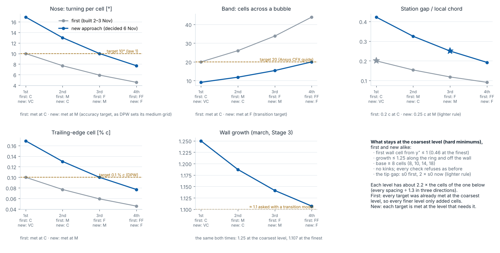

*What it shows.* Five rules on the four levels, first (grey) against new (blue, built 7 Nov), read from the code (`laws.py` with each config); green bars: the largest turning each level delivered in the new screen. Level names: first C, M, F, FF; new VC, C, M, F (the same four places on the ladder).

**Conclusion.** First, every target was met at the coarsest level, so the finer levels went far past it (44 cells per bubble at FF), while the cells grew about 2.2 × per level. New, each target is met where it is needed: the accuracy targets at M, as the DPW guidelines define their medium grid, and the transition target at F, where SU2 with LM will run. The coarse levels are coarser than before (16.9° per nose cell and 9.1 cells per bubble at VC): good enough for the SA mesh studies, not for transition. The wall rules do not change: y⁺ ≤ 1 and growth 1.25 at the coarsest level give 1.107 at F, just above the 1.1 a transition model asks for (1.23 at VC would give exactly 1.1).

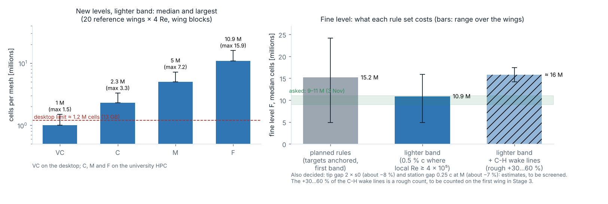

*What it shows.* The estimate of 6 Nov, before the build. Left: cells per mesh at the new levels with the lighter band, median and largest over the 20 reference wings × 4 Re levels (surfaces from the plan file × wall layers by formula; the wing blocks only). Right: the fine level F per rule set.

**Conclusion.** This first estimate put F at 10.9 M cells (median), inside the 9–11 M asked; the planned rules gave 15.2 M. Its wall-layer rule was not recorded, and it used the first-approach reference wings. The pages now use the count of studies 9 and 12 (F 6.73 M median on the reference wings, study 12, with the upper band at 0–100 % c; 6.70 M just before it, 6.9 M at the old Re levels), because its rule is written down and it can be redone. Both leave out the C-H wake lines (a rough +30–60 %). Stage 3 sets the real wall-layer rule.

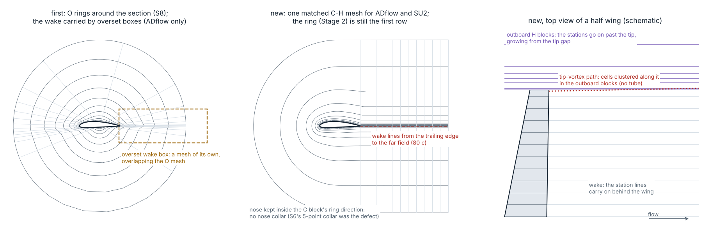

*What it shows.* Left: the first plan, O rings with an overset wake box (ADflow only). Middle: the new plan, one matched C-H mesh; the C rows wrap the nose and leave the trailing edge. Right: the new plan from above; the station lines go on behind the wing and past the tip. Schematic, not a mesh.

**Conclusion.** The surface mesh does not change: the ring is still the first row and the cap still closes the tip. The volume mesh changes (Stage 3, not built): a march from an open line at the trailing edge, wake lines to the far field, the tip vortex clustered in the outboard blocks instead of a tube, and no overlap gate. The nose must stay a spacing request inside the C block: a separate 5-point nose collar is what broke S6. The gain is one mesh family and one error bar for both solvers.

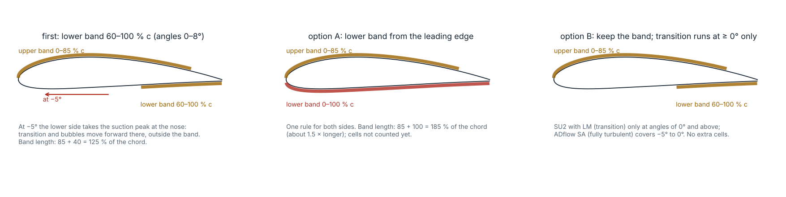

*What it shows.* The transition band on one section: the first band, and the two options for negative angles. Option A was chosen and built.

**Conclusion.** The first band was set for 0–8°. At −5° the lower side takes the suction peak near the nose, so its transition and bubbles move forward, out of the band (median 1–15 % c per type at −5°, study 8). Option A covers them with one rule for both sides, and it costs no cells, because both sides share one node list. Mike chose A on 7 Nov.

**What stays the same.** The six steps and the code (two changes: the nose is solved at every level and the strictest spacing wins; a nose repair goes on the whole family); the ring and the cap; the family rule (÷ 1.3 per level, growth g^(1/1.3)); the 13 checks; one surface per wing and Re level.

## 6. Weak points, said plainly

- **Numpy loft here; pyGeo checked on the reference wings only.** Every mesh so far was built on the numpy twin of the loft. On Mike's machine (8 Nov) the 20 reference wings on the pyGeo loft gave the same meshes as the numpy loft (VC and F: the same ring nodes and stations on 80 of 80 each; VC: every check value within 6 × 10⁻¹⁰). The full sets were not meshed on pyGeo.
- **No solve yet.** Nothing here shows that the surface gives a good volume mesh or a converged run.
- **The cap quads come close to the limit:** lowest 0.075 at VC, 0.080 at C, 0.057 at M, 0.061 at F, against 0.05 (every set at every level, study 12). With the band off they cross it: 0.0495 on all 20 BWB reference builds at M (study 13); the band stays on, so the runs are not affected. Similarity made some caps worse (study 10).
- **The stations are 17 % more than the plan.** The decided station growth 1.2 and 12 gaps per panel at M give 7–14 more stations than the plan file's 1.25 and 7 gaps per panel, so about 17 % more cells than the plan's rules would give. Confirmed by Mike on 8 Nov (decision 77).
- **The cell count is an estimate, and it hangs on the wall-layer rule.** This count: F 6.73 M median on the reference wings (5.91 M over every set), 10.21 M largest (one layer count per block, 2 chords deep). The first estimate of 6 Nov: 10.9 M, its rule not recorded. Both leave out the wake lines and the outboard blocks. Stage 3 sets the real rule.
- **The coarse levels get a finer nose than they ask.** The nose is solved at every level and the strictest wins, so VC turns 14.6–16.1° against 16.9°: the price of an exact family rule.
- **The coarse levels do not resolve transition.** VC and C have 9.1 and 11.8 cells per bubble, so transition results there must not be trusted.
- **The band rule rests on one source.** 20 cells per bubble comes from one vendor guide, for one model. The lighter band gives the shortest high-Re root bubbles (about 1.5 % c) only about 3 cells: fine for SA, wrong for LM.
- **The band count (study 8) still reads the flow at real size**, per flight speed; the refine map now runs at the Re levels (study 11).
- ~~**The upper band as written missed the upper transition at low Re**~~ (0–49 % of the strips fit 0–85 % c at 10⁵ and 3 × 10⁵): written 0–100 % c on 8 Nov (Mike); 2 more ring nodes on some meshes, cells at most +1.1 % (study 12).
- **No XFOIL answer on many tailless strips at −5°** (up to 46 % BWB, 42 % flying wing; 43 % on 7 Nov): the band there rests on the other angles.
- **Studies 1–8 used the old 20 reference shapes**, 13 of which were replaced on 7 Nov.
- **Starting values without a ladder:** the station gap, the 12 per panel, the tip gap and the 2 % c cap.

## 7. Open and to do, in order

1. ~~Nose re-measure (decision 64)~~ — done 7 Nov: real; fixed in Stage 1.
2. ~~Similarity in the generator~~ — done 7 Nov: sets rebuilt, 722 of 722.
3. ~~The lower band (74)~~ — done 7 Nov: option A, from the leading edge.
4. ~~Stage 2 code, the new rules~~ — done 7 Nov.
5. ~~New screen~~ — done 7 Nov (study 9).
6. ~~The nose at M (decision 77, point 2)~~ — done 7 Nov: solved at every level, the strictest wins.
7. ~~The refine map at the Re levels~~ — done 7 Nov (study 11): the lower band holds every strip; the upper band as written does not at low Re, but the built mesh has band-size cells there.
8. ~~Mike: confirm or change the two builder choices left~~ — done 8 Nov: both confirmed (decision 77); the upper band written 0–100 % c; a nose repair belongs to the family (decision 80).
9. ~~The family screen~~ — done 8 Nov (study 12): every set at every level, 3,128 of 3,128 pass, 0 nose repairs.
10. **pyGeo run (Mike's machine): done on 8 Nov.** pyGeo tests 24, Stage 1 tests 204, `build --all` 722 of 722 (manifests pushed), Stage 2 tests 41; the reference meshes on pyGeo equal the numpy ones (VC and F). Stage 1's label fix (decision 79, 8 Nov) changed every input hash but no surface, so every mesh and screen here stands.
11. **pyGeo `build --all` once more (Mike's machine):** new input hashes after the label fix; the surfaces are the same.
12. ~~Fix the BWB tip cap for the band off~~ — not needed (Mike, 9 Nov): the band stays on for every run; no cap change (study 13).
13. **Close Stage 2 (Mike's word):** final page, summary and handover; notify. The surface rules are frozen (82). Right before the runs: the solver split (76).
14. **Stage 3:** the matched C-H volume mesh on one wing first, count its cells, then the first solves.
15. **Ladders after the first solves:** chordwise (cells per bubble, the band), spanwise (station gap, tip gap), the nose angle (12, 10, 8, 6°).
16. **Decide 65 and 66** (the per-wing band; AVL and NeuralFoil for the flow dataset) after the first 3-D transition runs, with the flow dataset per Re level at unit mean chord.

## 8. Handover to Stage 3 (the volume mesh)

- **Input per mesh:** `surface.npz` with the wing rings (ring index first, root to tip) and the cap; x/c of every node; `stations.csv` with the local Re and chord per station; `quality.json` with the tip's first cell `s0_tip_m` and every rule value with its reason. The wings are at unit mean chord; one surface per wing, level (VC, C, M, F) and Re level.
- **The march:** first cell s0 per station from the local Re and y⁺ (1 at VC, 0.46 at F); growth ≤ 1.25 at VC in the boundary layer (1.107 at F, just above the 1.1 a transition model asks for); at least 30 cells across it; reach about 2 chords; the last station gap at the tip is 2 × s0. Study 12 counted the wing blocks with this march: F 6.73 M cells median on the reference wings, 5.91 M over every set (largest 10.21 M).
- **The family:** every spacing ÷ 1.3 per level and the growth g^(1/1.3), in the volume too; base cells 8, 10, 14, 18 at VC, C, M, F.
- **First plan (replaced on 6 Nov; kept as a fallback and for future work, owner 9 Nov; not built):** overset boxes: background 0.03 c, wake box 0.0075 c to 2 c then to 10 c, a tube with 15–20 cells across the vortex core from 2 c behind the tip, far field 80 c; the overset export and the overlap gate.
- **New plan: one matched C-H mesh for ADflow and SU2.**
  - The C block wraps the ring, and the nose stays a spacing request inside it: no collar.
  - Wake lines run from the trailing-edge corners and the base to the far field (80 c), fine near the trailing edge (0.0075 c as the starting value).
  - The stations go on past the tip into outboard blocks, growing from the tip gap. The tip vortex is resolved there by clustering cells along its path (no tube). The cap is the wall of the first outboard block.
  - Structured CGNS for ADflow; a converter to unstructured hexes (.su2) for SU2.
  - Rough cost: +30–60 % cells on the wing blocks, to be counted on the first wing.
- **Test the march first** on the tip squeeze, on the caps whose quads come closest to the limit (studies 9 and 12), on the corner wings, and on the new open-line march at the trailing edge.

**Sources.** Levy et al. 2013 (DPW gridding guidelines); Celik et al. 2008 (grid convergence, r ≥ 1.3); Ansys CFX Modeling Guide, γ-Re_θ transition-model grid requirements; White, *Viscous Fluid Flow* (flat-plate friction); the AERIS Mesh Automation Primer, Annex G (the Grand Roadmap); S8 (the AERIS mesh study); AERIS ADR-0020 (ADflow memory: 1.51 GiB + 9.46 GiB per million cells). Decisions: `CFD_Automation/OPEN_DECISIONS.md` 56–82.
