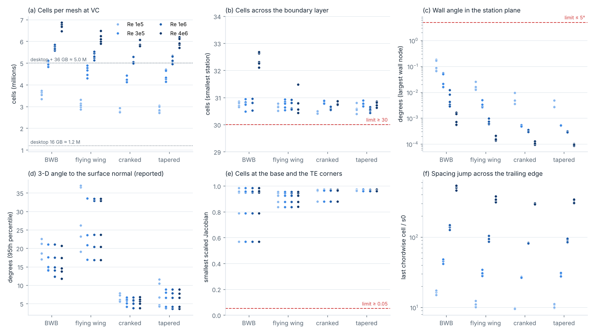
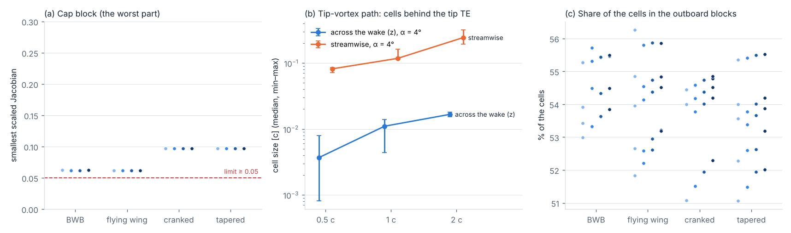
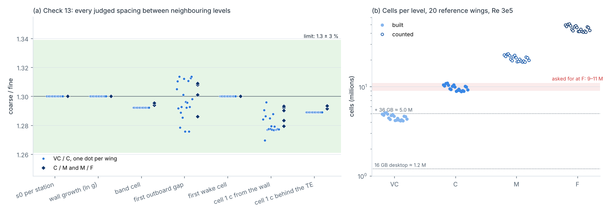
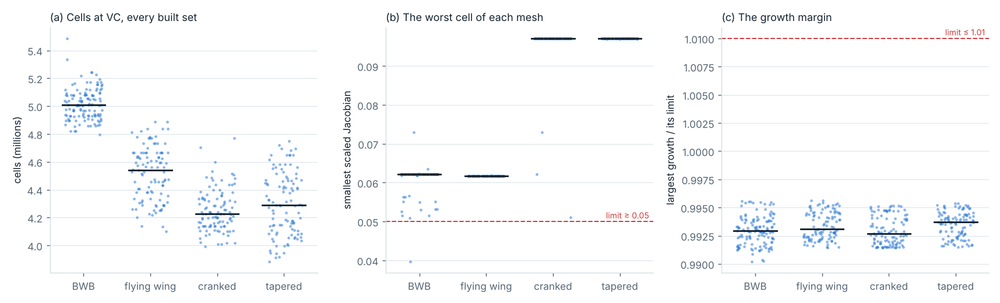
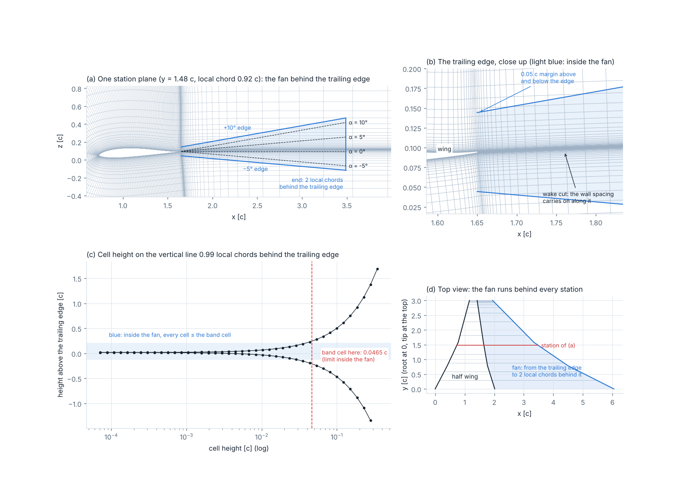
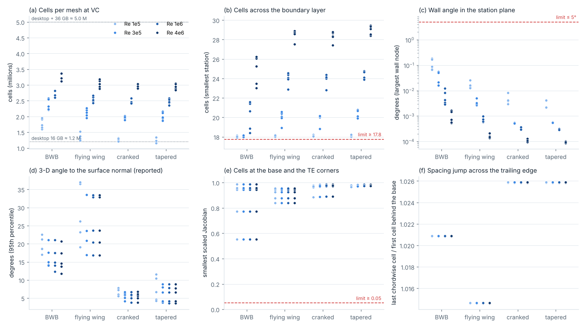
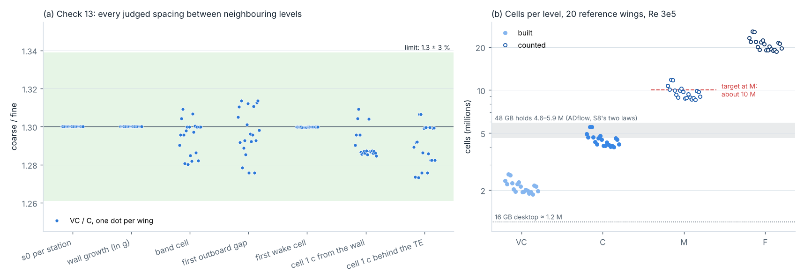
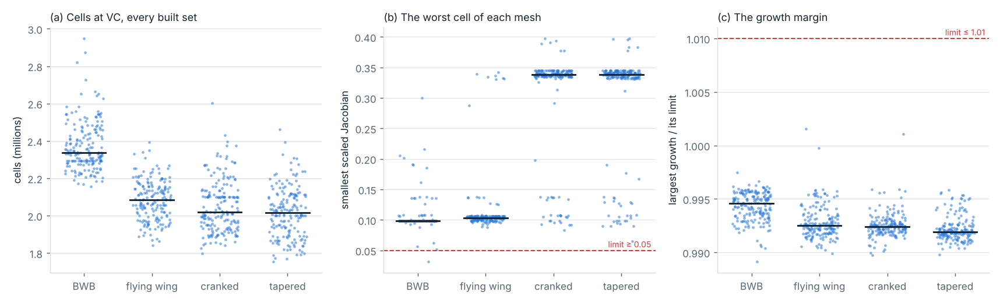

# Stage 3 — volume mesh: the plan, the rules and the checks (V0, 9 Nov 2026)

Branch `stage3-volume-mesh` (from `stage2-surface-mesh`), in main since 10 Nov 2026. Code:
`CFD_Automation/cfdauto/volume/`. Rules: `configs/volume.yaml` (rule set 2; rule set 1 in `configs/volume_rules1.yaml`).
Decisions 84–113 in `CFD_Automation/OPEN_DECISIONS.md`.

## 0. In one breath

- One matched C-H multiblock mesh on the frozen Stage 2 surface (decision 73), for ADflow (structured CGNS) and SU2
  (the same mesh as unstructured hexes, `.su2`).
- Every wall node is a Stage 2 node. The volume code is new (`cfdauto/volume/`); `cfdauto/mesh/` is not touched.
- In each station plane (y = const) a C around the ring and the wake, out to the far field. The planes are stacked
  root to tip; past the tip the tip plane is swept outboard, and the tip cap with it.
- Every check and its limit is in this file and in `configs/volume.yaml`. They were written before any mesh was
  judged and their limits have not changed (check 10 got a 1e−9 c round-off tolerance in V2; check 3 got Stage 2's
  exemption for the cap's two nose-corner columns in V4, decided by Mike, decision 101). The
  construction changed ten times in rule set 1 (section 7) and three times in rule set 2 (section 16), each after a
  check failed. Results: rule set 1 in sections 8–14; rule set 2 (decisions 107–111: M about 10 M cells, angles −5° to
  +10°) in sections 15–17; the conclusion in 17.5.

## 1. The plan

| Step | What | Ends with |
| --- | --- | --- |
| V0 | rules, checks and limits; how to build a station plane (measured); the boundary-layer law (measured) | this file; Mike's word on the checks |
| V1 | BWB reference wing 0, VC, Re 3 × 10⁵: the 13 blocks, every check, slices, cells against Stage 2 | a conclusion |
| V2 | wall layers, fine zone, far field on the 20 reference wings at VC; orthogonality at the nose and the base | a conclusion |
| V3 | the cap block and the outboard H blocks; the tip-vortex rule; cap and outboard quality on every reference wing | a conclusion |
| V4 | the family VC, C, M, F (as memory allows; F counted if it does not fit); every spacing ratio | a conclusion |
| V5 | CGNS writer and reader (ADflow), `.su2` converter (SU2); round trips; tests | tests pass |
| V6 | the screen: every built set at VC (not the hold-outs), C and M where memory allows, F counted | pass / refuse / review |
| V7 | first solves: ADflow SA, SU2 SA, SU2 SST + LM on one wing (here: run scripts and a runbook) | smoke test |
| V8 | the hold-outs, once, rules frozen, with Mike's OK | the result as it is |
| V9 | page, summary, status, handover to Stage 4 | Mike closes Stage 3 |

## 2. The C-H layout: 13 blocks

In one station plane, six blocks; every block is right-handed with k along +y (root → tip).

| Block | i runs | j runs | Wall | Far field | Matched |
| --- | --- | --- | --- | --- | --- |
| WU (upper wake) | outflow → trailing edge along the upper wake line | up to the far field | — | iMin (outflow), jMax | iMax = CU iMin; jMin = B iMax |
| CU (upper side) | ring 0 (upper TE corner) → start of the cap's nose arc | out to the far field | jMin (wing) | jMax | iMax = CN iMin |
| CN (nose arc) | the n_base ring nodes of the cap's nose arc | out | jMin | jMax | iMax = CL iMin |
| CL (lower side) | end of the nose arc → ring 2 n_side − 2 (lower TE corner) | out | jMin | jMax | iMax = WL iMin |
| WL (lower wake) | trailing edge → outflow along the lower wake line | down to the far field | — | iMax (outflow), jMax | jMin = B iMin |
| B (base) | across the base, lower → upper wake line | along the wake to the outflow | jMin (the base) | jMax (outflow) | iMin = WL jMin; iMax = WU jMin |

- `*_in`: these six from the root (kMin: symmetry, y = 0) to the tip (kMax = `*_out` kMin).
- `*_out`: the same six from the tip to the far field past the tip (kMax: far field). Their jMin faces (CU, CN, CL)
  and B's jMin are matched to the sides of the cap block.
- `CAP`: the Stage 2 tip cap (n_chord × n_base) swept outboard. kMin = the cap (wall), kMax far field; its four sides
  are matched to CU_out, CN_out, CL_out (jMin) and B_out (jMin).
- Every face is one boundary condition or matched node to node with one face of one other block (no partial faces).
  The table is `cfdauto/volume/topology.py`.

## 3. The rules (anchors as in Stage 2; r = 1.3)

| Rule | Anchor value | VC | C | M | F | Why |
| --- | --- | --- | --- | --- | --- | --- |
| First wall cell s0 (law 13) | y⁺ 1 at VC | y⁺ 1 | 0.77 | 0.59 | 0.46 | Stage 2's law, per station at its local Re; the same s0 off the base and off the cap |
| Wall growth, inside the fine zone | 1.25 at VC | 1.25 | 1.187 | 1.141 | 1.107 | decision 71 (DPW) |
| Cells across the boundary layer | 30 at VC | 30 | 39 | 50.7 | 65.9 | Annex G: ≥ 30 at the baseline; decision 86 |
| Boundary-layer thickness δ | turbulent flat plate at the trailing edge, from the local Re | | | | | decision 86 (measured, section 6.2) |
| Fine zone | 2 local chords | same | | | | law 20; the depth Stage 2's estimate used |
| Growth beyond the fine zone, checked | 1.30 at VC | 1.30 | 1.224 | 1.168 | 1.127 | Annex G: ≤ 1.3 anywhere outside the boundary layer; decision 85 |
| ... built | 1.22 at VC | 1.22 | 1.165 | 1.125 | 1.095 | built below the limit, as Stage 2 builds the ring at 1.2 and checks 1.25: the far-field blend raises it (section 7, changes 5 and 10) |
| Far field | 80 mean chords | same | | | | law 15; 40 / 80 / 160 is Stage 4 (T2) |
| Wake band: angles | −5° to 20°, margin 0.05 c | same | | | | the brief: −5° to post-stall; decision 87 |
| Wake band: length | 2 local chords behind the trailing edge | same | | | | law 20 (the fine zone) |
| Wake band: cell at the trailing edge | 0.0075 c at M | 1.27 % c | 0.98 % c | 0.75 % c | 0.58 % c | Primer section 05 (about 20 cells across a 0.15 c wake) |
| Wake band: cells across the fan | 40 at M | 23.7 | 30.8 | 40 | 52 | decision 87: the cell grows with the distance so the fan keeps this many cells |
| Wake band: streamwise cell | ≤ 4 × the band cell | same | | | | decision 87 |
| Wake: first cell behind the base | s0 of the station | | | | | the base is a wall (decision 90) |
| Outboard: first gap | the wing's last gap (2 s0 at the tip) | | | | | law 10 / 12 |
| Outboard growth, to 2 c past the tip | 1.15 at VC | 1.15 | 1.114 | 1.086 | 1.066 | the brief's starting value (law 12) |
| ... beyond, to 80 c past the tip | the far growth: 1.3 at VC (the checked value; a 1-D spacing, no blend) | 1.3 | 1.224 | 1.168 | 1.127 | decision 88 (section 7, change 9) |
| Base cells | Stage 2: 8 / 10 / 14 / 18 | | | | | Stage 2 decision 61 (frozen) |

How a station plane is built (decision 84, section 6.1):
1. The C line: upper wake line (outflow → corner), the Stage 2 ring from the upper to the lower corner, the lower wake
   line (corner → outflow). The wake centre line leaves the base along its normal and turns to +x over 0.5 local chord;
   the two wake lines are parallel to it, the base height apart.
2. The line shapes: one front moved the same distance everywhere from the C line, smoothed along itself over a width
   κ × its distance from the wall (κ = 1; at the wall no smoothing, so the lines leave square to it), through the fine
   zone; then a straight piece to the far-field node. The far-field nodes are the mean over the stations of where the
   lines would land, so the far field is one grid extruded along the semi-span.
3. The nodes: one wall-normal distribution per station (s0, the boundary-layer zone, the fine zone, the wake band as an
   envelope in height, the far growth), the same count for every station; each line keeps it near the wall and shortens
   only its outer part to its own length. The wake lines keep the wall spacing along the cut (as classic C meshes do).
   To give every station the same count, its growth (never the band cell) is scaled down by one factor; past the band
   the envelope keeps rising at the growth law's own rate (g − 1), so the cells leave the band smoothly (section 7,
   changes 7 and 8).
4. The outer layers of every station move toward the station mean (smoothstep from the first layer past every
   station's fine zone and band, to the far field), and the far wake nodes toward the station-mean x: neighbouring
   stations then line up far out, and the cells between them stay square.
5. The base block between the two wake lines by transfinite interpolation.
6. If a cell folds, every station is rebuilt with the next smoothing (κ = 1, 1.5, 2, 3); the rung is stored.

The tip vortex (law 19): its path from the tip trailing edge at −5° to 20° lies inside the wake band (in the plane);
along the semi-span it is held by the tip squeeze inboard (Stage 2: last gap 2 s0, growth 1.2) and by the outboard
stations (first gap the same, growth 1.15). No other clustering (decision 88). V3 measures the cells at the path.

## 4. The checks and their limits

Written before any mesh was judged (`configs/volume.yaml`, `checks:`). A mesh refuses if any refusing check fails
(it writes only `refusal.json`: which check, its value, its limit).

| # | Check | What is measured | Limit | Refuses | Why |
| --- | --- | --- | --- | --- | --- |
| 1 | Wall on the surface | every wall node (wing, base, cap) against the Stage 2 node | ≤ 1e−12 c | yes | decision 82: the surface is frozen |
| 2 | No folded cell | the Jacobian at every corner of every cell | > 0 | yes | a folded cell stops the solver or gives nonsense |
| 3 | Cell quality | the smallest corner scaled Jacobian of every cell; since 9 Nov (decision 101, Mike) but the CAP block's two columns over the cap's two nose-corner quads, reported on their own as Stage 2 does | ≥ 0.05 | yes | Stage 2's limit for the surface quads; the cap's cells inherit it, and its exemption |
| 4 | Wall orthogonality | in the station plane, the angle between the first grid line and the ring normal (bisector), every wall node but the two trailing-edge corners | ≤ 5° | yes | the boundary layer needs lines square to the wall; the 3-D angle is reported (decision 89) |
| 5 | First cell | the first cell of every wing and base line against the station's s0 | within 1 % | yes | law 13; y⁺ ≤ 1 is a hard minimum |
| 6 | Growth | along every wall-normal line: inside the fine zone against the wall growth, beyond against the far growth | ≤ limit × 1.01 | yes | DPW; Annex G |
| 7 | Cells across the boundary layer | cells between the wall and δ (turbulent flat plate at the trailing edge, local Re) | ≥ 30 at VC (39, 50.7, 65.9) | yes | Annex G; decision 86 |
| 8 | Interfaces | every matched pair of faces, node to node; no open face | ≤ 1e−10 c | yes | a gap is a hole in the domain |
| 9 | Symmetry plane | y on every root face | \|y\| ≤ 1e−12 c | yes | ADflow and SU2 need a true plane |
| 10 | Far field | the distance from every far-field node to the nearest wall node | ≥ 80 c (round-off 1e−9 c, V2) | yes | law 15 |
| 11 | Wake | the streamwise growth along the wake lines (wall growth inside the band length, far growth beyond); every cell inside the band against the band cell | ≤ limit × 1.01 | yes | laws 17, 18 |
| 12 | Outboard | the first gap past the tip against the wing's tip gap; the growth (1.15 to 2 c, the far growth beyond) | 1 %; × 1.01 | yes | law 12 |
| 13 | Family ratios | between neighbouring levels: s0 per station, the wall growth limit, the band cell, the first outboard gap, the first wake cell, the cell at 1 local chord from the root's wall and behind the root's trailing edge | 1.3 within 3 % | yes (V4) | law 23; exceptions named: the base cells 8 / 10 / 14 / 18 (Stage 2) and the whole-number counts (layers, wake nodes, outboard stations) |
| 14 | Cells and RAM | cells; RAM = 1.51 GiB + 9.46 GiB per million cells (ADflow, ANK only) | information | no | where a mesh fits: desktop 16 GB ≈ 1.2 M cells; + 36 GB ≈ 5 M; F on the HPC |
| 15 | Export round trip | the CGNS file read back against the arrays; the `.su2` file: nodes, cells, markers, no inside-out cell | exact (CGNS); counts equal (`.su2`) | yes (V5) | the solvers must see the mesh that was checked |

Three outcomes:
- **passed**: every refusing check passes and no review flag is raised;
- **refused**: a refusing check fails (`refusal.json`);
- **needs review**: every check passes, but R1 is raised: the plane grid needed a smoothing rung above the first
  (κ > 1), so a human looks at the far field before it is used.
- A failure stays in every count.

Also reported (not checked): the 3-D angle between the first line and the surface normal (median, 95th percentile,
largest); the in-plane angle at the two trailing-edge corners; the smallest scaled Jacobian per block; the spacing
jump across the trailing-edge line (the last chordwise cell of the wing, Stage 2's 0.1 % c at M, against the first
cell behind the base, s0); the smoothing rung; the build time.

## 5. Planar stations and the 3-D wall angle (decision 89)

- Every Stage 2 ring lies in its plane y = const (measured: within 4e−15 c). The volume lines stay in that plane.
- So the lines are square to the wall in the plane, but not in 3-D where the surface is swept or has dihedral: at a
  swept nose the angle between the line and the surface normal is the sweep. The cell is then sheared, not folded;
  its first cell is s0 · cos(angle) along the normal, so y⁺ falls.
- The refusing check (4) is the in-plane angle, which the mesher controls. The 3-D angle is reported on every mesh.
  A 3-D march would bend the station planes near the wall; near the tip, where the stations are 2 s0 apart, they
  would cross. Not built unless a solver result shows a problem.

## 6. The V0 measurements

### 6.1 How to build a station plane (`scripts/plane_method_study.py`, `data/studies/plane_method.json`)

The same inputs for three methods: the same C line, far-field nodes and node distribution. Every station plane of 8
reference wings (2 per type) at VC, Re 3 × 10⁵: 501 planes. No volume mesh was judged.

| Method | Planes with a folded quad | Smallest scaled Jacobian (median of the planes) | Largest in-plane wall angle | Growth / limit | Time |
| --- | --- | --- | --- | --- | --- |
| march (front with smoothing, then straight; the nodes placed along the lines) | 0 of 501 | 0.626 (0.927) | 0.05° | 0.997 | 6.6 s |
| algebraic (cubic lines from the wall normal to the far-field node) | 501 of 501 | −1.0 | 0.00004° | 0.998 | 5.8 s |
| elliptic (the algebraic grid + 300 Winslow sweeps past the fine zone) | 501 of 501 | −1.0 | 0.00004° | 15.4 | 231 s |

- What it shows: the algebraic lines cross at the two trailing-edge corners, where the C line turns inward by about
  half the trailing-edge wedge angle (cranked wing 0, station 10: 314 folded quads of 29,520, all near the corners,
  from 0.0004 c out to the far field). 300 Winslow sweeps do not untangle them and destroy the growth outside the
  held fine zone.
- Conclusion: **the march** (decision 84). The options are not close, so this is not a question for Mike.
- A 3-D march is not needed for validity: with planar stations a stacked cell can only fold if neighbouring plane
  grids differ in shape; V1 shows this happens far out unless the far field is shared (section 3, step 4).

### 6.2 Which boundary-layer thickness the 30 cells cross (`scripts/bl_law_study.py`, `data/studies/bl_law.json`)

Counts only (no mesh): the wall-layer count each variant needs at VC (the most over the stations), the 20 reference
wings × 4 Re levels.

| Variant | Layers at VC, median (largest) at Re 1e5 / 3e5 / 1e6 / 4e6 | Smallest growth it needs inside δ |
| --- | --- | --- |
| turbulent, at the trailing edge, 30 at VC | 88.9 (92.3) / 89.3 (93.3) / 89.8 (94.2) / 90.7 (97.2) | 1.022 at Re 1e5 |
| turbulent, at mid-chord, 30 at VC | 93.3 (96.4) / 92.9 (97.1) / 93.0 (97.2) / 93.3 (98.1) | 1.000: infeasible at Re 1e5 |
| laminar (Blasius), at mid-chord, 30 at VC | 99.7 (104.2) / 100.7 (105.3) / 102.2 (107.2) / 104.2 (109.2) | 1.000: infeasible at Re 1e5 |
| turbulent, at the trailing edge, 30 at M | 75.2 (81.7) / 79.8 (86.2) / 84.8 (91.2) / 90.7 (97.2) | 1.094 |
| laminar, at mid-chord, 30 at M | 82.8 (87.3) / 84.3 (89.3) / 86.2 (91.2) / 90.7 (97.2) | 1.029 |

- What it shows: at Re 10⁵ the small tips have a layer thinner than 30 first cells at mid-chord (laminar or
  turbulent), so 30 cells at VC cannot be met there by any growth. At the trailing edge the turbulent layer always
  fits 30 cells. The rule costs little: the wake band and the fine zone already set most of the layers (88–97).
- Conclusion: **δ = turbulent flat plate at the trailing edge (0.37 x Re_x^−1/5, x = the local chord), from the local
  Re; 30 cells at VC, × 1.3 per level** (decision 86). Weak point: the laminar layer at mid-chord gets fewer cells at
  VC; the family gives it more at F (growth 1.107, y⁺ 0.46).

## 7. What changed while V1–V4 were built (the construction, never a limit)

The checks and limits above were written in `configs/volume.yaml` before the first mesh was built, and have not
changed. Building V1 (BWB reference wing 0, VC, Re 3 × 10⁵), the construction changed five times after checks failed:

1. Marching the nodes themselves layer by layer folded (1,000+ quads per plane): the lines have different node
   distributions (wall lines, wake lines), so each layer tilted across the trailing edge. Now the line shapes come
   from one front, and the nodes are placed along them (decision 84).
2. Per-line distributions made slivers where the lines behind the trailing edge bunch (they keep the wake's
   streamwise clustering, s0, up to the far field). Now one distribution per station for every line, the band as an
   envelope in height, the wall spacing kept along the cut, the wake lines parallel.
3. The fill of the count by one factor stalled at zone boundaries (the growth limit jumped there, so the count jumped).
   Now every change of limit ramps over 25 % of its distance past the boundary (the limit holds up to it).
4. The stacked cells were sheared to a scaled Jacobian of 0.001 between neighbouring stations: the far-field nodes moved
   with the local chord much faster than the stations are apart near the tip (2 s0). Now the outer layers and the far
   wake nodes move to the station mean (section 3, step 4).
5. That move raised the growth 3 % above 1.3 on the root's wake lines. Now the far zone is built at the wall growth
   (1.25 at VC) and checked at 1.3, as Stage 2 builds the ring at 1.2 and checks 1.25.

After these, BWB reference wing 0 at VC passes every check (V1). Five more changes came in V2 and V4; again no limit
changed, and every V2–V7 number in this file is from the code after all of them:

6. **Check 10 compared floats exactly (V2).** The outboard far field is placed exactly 80 c past the tip, so the
   distance is 80 c to round-off. On the first screen 6 of the 80 reference meshes read 79.99999999999999 c and were
   refused (flying wing 2 at Re 10⁶ and 4 × 10⁶; tapered 4 at all four Re). The check now allows 1e−9 c of round-off;
   the limit stays 80 c. Rebuilt, all 6 pass. The first screen is kept in `data/studies/old/`.
7. **The count factor scaled the band cell too (V4).** One factor per station (λ ≤ 1) fits every station to the same
   layer count. It scaled the growth and the band cap together, so where a station had spare layers its band cells were
   smaller than the rule, by a different amount at each level: on BWB reference wing 0 the band cell at 0.5 local chord
   behind the root fell to 91 % of the rule at VC and 95 % at C, so VC/C = 1.24 (check 13 asks 1.3 ± 3 %). Now λ scales
   the growth only; the band cell is the rule at every station and level (VC/C = 1.292). Tried first and dropped: λ
   only past 2 local chords. Checks 3 and 6 refused it on the same wing (scaled Jacobian 0.014, growth 1.05 × the
   limit): neighbouring stations then differed too much in their outer layers.
8. **The cells left the band abruptly (V4).** Past the band height the cap rose by 10 × the distance, so the cells
   jumped from the band cell to free growth at whichever node came first past it. That node falls in a different place
   at each level, so the cell 1 local chord from the root's wall was off: VC/C 1.232–1.259 on 4 of the first 9
   families (limit 1.3 ± 3 %). Now the cap keeps rising past the band at the growth law's own rate (a geometric line
   has dh/dx = g − 1), so the cells leave the band smoothly: 1.265–1.289 on the same wings.
9. **Decision 88's text said the outboard far growth is built at 1.25 (V2).** The code builds the station gaps past the
   outboard fine zone at the checked value 1.3: they are a 1-D spacing with no blend, so no margin is needed, and check 12
   holds them at ≤ 1.3 × 1.01. The text is corrected; no mesh changed.
10. **The far-field blend pushed one root over the growth limit (V2, second screen).** After change 8, BWB reference wing 4
    at Re 4 × 10⁶ was refused by check 6: growth 1.313 against 1.3 × 1.01 (1.0100 × the limit), on a root wake line at
    layer 85, where the outer layers start moving to the station mean (the move adds its own stretch where the root's
    line differs most from the mean). Now the far zone is built at 1.22 at VC (1.165, 1.125, 1.095 at C, M, F), not at
    the wall growth 1.25: the worst growth on that mesh falls to 0.993 × the limit, in the boundary layer. Cost: one
    more layer on that wing (99 → 100). The first two screens are kept in `data/studies/old/`.

With all ten changes, V1 (BWB reference wing 0, VC, Re 3 × 10⁵) was rebuilt: 4,930,448 cells (it had 4,853,800):
95 layers, 74 wake nodes, 377 C-line nodes, 61 + 75 stations; every check passes; ADflow RAM 48.2 GiB (7.59 × Stage 2's
estimate). `data/studies/v1.json` and `docs/page/v1_slices.png` are the rebuilt ones.

## 8. V2: wall layers, fine zone and far field (the 20 reference wings × 4 Re, VC)

`scripts/screen.py --sets reference --re 1e5 3e5 1e6 4e6` (two halves, tags `ref_VC_a`, `ref_VC_b`), then
`scripts/v23_study.py` → `data/studies/v23.json`, `docs/page/v2_wall.png`. 80 meshes, built with every change of section 7.

*What it shows.* One dot per mesh, by wing type; light to dark from Re 10⁵ to 4 × 10⁶. (a) cells; (b) cells across the
boundary layer at the worst station; (c) the largest in-plane angle between the first line and the wall normal; (d) the
95th percentile of the 3-D angle to the surface normal (reported, not judged); (e) the worst cell next to the base and
the trailing-edge corners; (f) the wing's last chordwise cell over the first cell behind the base.

| What | Measured (80 meshes) | Limit |
| --- | --- | --- |
| Outcome | 80 passed, 0 refused, 0 review (smoothing rung 0 on all) | |
| Cells | 2.71–6.87 M (median 5.02 M); Re 10⁵ 2.7–3.7 M, 3 × 10⁵ 4.1–5.1 M, 10⁶ 4.9–5.9 M, 4 × 10⁶ 5.7–6.9 M | |
| ADflow RAM | 27–67 GiB; fit 16 GB: 0 of 80; fit 52 GB: 40 of 80 | information |
| Layers · wake nodes · stations · outboard stations | 91–100 · 66–86 · 51–82 · 67–92 | |
| Cells across the boundary layer (worst station) | 30.39–32.69 | ≥ 30 |
| First cell against s0 | ≤ 0.028 % | ≤ 1 % |
| Growth / its limit | 0.9915–0.9960 | ≤ 1.01 |
| Wall angle in the plane (nose; off the base) | ≤ 0.18° (0.18°; 0.0095°) | ≤ 5° |
| The two trailing-edge corners | 2.7–8.8° | not judged |
| 3-D angle to the surface normal: median, 95th percentile, largest | 1.1–5.2°, 4–37°, 6–40° | reported (decision 89) |
| Cells next to the base; at the TE corners (smallest scaled Jacobian) | 0.57–1.00; 0.57–0.99 | ≥ 0.05 |
| Spacing jump across the trailing-edge line | Re 10⁵ 10–17; 3 × 10⁵ 26–48; 10⁶ 81–148; 4 × 10⁶ 293–537 | reported (decision 90) |
| Far field | 80.0 c | ≥ 80 c |
| Wake: growth and band cells / limit | ≤ 1.0009 | ≤ 1.01 |
| Smallest scaled Jacobian of the mesh | 0.062–0.097 (always the cap) | ≥ 0.05 |

**Conclusion.** All 80 pass. The wall rules hold on every wing at every Re: at least 30.39 cells across the boundary
layer, first cells within 0.03 %, growth at most 0.996 × its limit, square to the wall in the plane (≤ 0.18°), the
far field at 80 c. The base and the trailing-edge corners have good cells (≥ 0.57). The weak points are four: (1) cost,
no mesh fits the 16 GB desktop and only 40 of 80 fit 52 GB; (2) the planar stations shear the first cells at swept
noses, up to 40° off the surface normal in 3-D (y⁺ only falls); (3) the spacing jump across the trailing-edge line
reaches 537 at Re 4 × 10⁶, because the base is a wall at y⁺ 1 next to the wing's last chordwise cell; (4) the
tightest checks are the growth (0.996 × its limit at the most) and the band cells (1.0009 × the band cell at the most;
both limits allow 1.01).

## 9. V3: the cap, the outboard blocks and the tip vortex (the same 80 meshes)

*What it shows.* (a) the worst cell of the CAP block per mesh; (b) the cells on the tip-vortex path at 4°, 0.5, 1 and 2
local chords behind the tip trailing edge (median, and the range over the 80 meshes), across the wake (z) and along it;
(c) the share of the cells in the outboard blocks.

| What | Measured (80 meshes) | Limit |
| --- | --- | --- |
| Cap block, smallest scaled Jacobian | 0.0617–0.0971: the worst part of all 80 meshes | ≥ 0.05 |
| Outboard blocks · inboard blocks, smallest scaled Jacobian | 0.77–0.97 · 0.18–0.88 | ≥ 0.05 |
| Outboard: first gap against the tip gap; growth | exact; within its limits (check 12 on all 80) | 1 %; × 1.01 |
| Share of the cells outboard | 51–56 % (median 54 %) | |
| Vortex path at 4°, across / along, 0.5 c | 0.0037 / 0.082 c (median) | |
| ... 1 c | 0.0110 / 0.118 c | |
| ... 2 c | 0.0167 / 0.243 c | |
| ... at 20°, 2 c (the band's edge) | 0.080 (largest 0.138) / 0.243 c | |
| Station gap next to the tip (largest of the 30 either side) | 0.0019–0.0709 c | |

**Conclusion.** The cap and the outboard blocks pass on all 80. The cap's cells are the worst cells of every mesh
(0.062 at the lowest): they are the Stage 2 cap quads swept outboard, so a better cap belongs to the frozen surface. The
outboard blocks are good (≥ 0.77) but hold 51–56 % of the cells: in a matched mesh every outboard station carries the
whole plane. The tip-vortex path is fine across the wake (0.004–0.017 c at 4°) and coarse along it (0.08–0.24 c, the
band allows 4 × the cross cell); at 20° and 2 c it sits at the band's edge (0.08 c). Enough to carry the vortex, not to
resolve its core. Whether that matters is a solver question (V7, then the mesh study of Stage 4).

## 10. V4: the family VC, C, M, F (the 20 reference wings, Re 3 × 10⁵)

`scripts/family_study.py` (per wing: the Stage 2 family, the volume built at the levels that fit here, counted at the
rest; check 13 on the built ones), `scripts/v4_study.py` → `data/studies/v4.json`, `docs/page/v4_family.png`.
VC and C built on all 20; M built on one wing per type; F built on BWB and flying-wing reference wing 0; every level
counted.

*What it shows.* (a) Check 13: every judged spacing, coarse over fine, between neighbouring levels: one dot per wing
for VC/C, diamonds for C/M and M/F on BWB reference wing 0; the green band is 1.3 ± 3 %. (b) Cells per level on the 20
reference wings (VC and C built, M and F counted), against the 16 GB and 52 GB desktops and the 9–11 M asked for at F.

| Judged spacing (check 13) | VC / C, 20 wings | C / M, M / F (BWB 0) |
| --- | --- | --- |
| s0 per station (worst station) | 1.3000–1.3001 | 1.3000; 1.3000 |
| wall growth (ln g) | 1.3 | 1.3; 1.3 |
| band cell (at the band edge, 0.5 local c behind the root) | 1.2923 | 1.2941; 1.2954 |
| first outboard gap | 1.276–1.314 | 1.309; 1.286 |
| first wake cell | 1.3000 | 1.3000; 1.3000 |
| cell 1 local c from the root's wall | 1.270–1.296 | 1.290; 1.283 |
| cell 1 local c behind the root's TE | 1.289 | 1.291; 1.293 |
| counts (named exceptions): layers · wake nodes · outboard stations · stations · C-line nodes · base | 1.28–1.29 · 1.27–1.30 · 1.28–1.30 · 1.25–1.29 · 1.28–1.30 · 1.22 | |
| cells | × 2.11–2.16 | |

| Level | Cells: median (range), 20 wings | ADflow RAM, median | Built here |
| --- | --- | --- | --- |
| VC | 4.55 M (4.13–5.12) | 45 GiB | 20 of 20 passed |
| C | 9.73 M (8.85–10.97) | 94 GiB | 20 of 20 passed |
| M | 20.79 M (18.99–23.48), counted | 198 GiB | 4 of 4 pass with decision 101 (BWB 0, flying wing 0 refused by check 3 before it) |
| F | 45.35 M (41.27–50.71), counted | 431 GiB | BWB 0, flying wing 0 pass with decision 101 (refused before it) |

The counter (`count_volume`) against the built meshes: within 0.6 % at M (cranked 0 exact, tapered 0 −0.6 %). Building
is cheap: M 46–81 s and 1.1 GiB, F 110 s and 2.2 GiB peak. The solver is the cost.

**The refusals at M and F (check 3).** On the BWB and the flying wing, the worst cells are the CAP block's two columns
over the cap's two nose-corner quads: 0.0447 at M and 0.0367 at F on BWB 0 (0.0458 and 0.0380 on flying wing 0),
against 0.05. Stage 2 exempts exactly these two quads from its 0.05 limit ("three corners on the smooth ring: the corner
angle is 180° minus the ring's turning"; reported on their own, folded = refused), and the angle shrinks with the
turning, so it falls level by level (0.062 at VC, 0.053 at C). The volume cannot do better: the cells sit on the frozen
quads, and the outboard planes repeat the tip ring. Every other cell of these meshes is ≥ 0.077 (BWB 0: 0.0775 at M,
0.0795 at F; flying wing 0: 0.0855, 0.0871), and every other check passes (`data/studies/v4_cap_split.json`). The
cranked and tapered caps pass (their corner angles are larger).

**Decided (Mike, 9 Nov 2026; decision 101): exempt the two columns, as Stage 2 does.** Check 3 now judges every cell but
these two columns, which are reported on their own; a folded cell there still refuses the mesh (check 2). Rebuilt with
it: BWB 0 at M and F and flying wing 0 at M and F pass (every other cell ≥ 0.077, every other check passed before too).
The VC and C screens are unchanged by it (the two columns are ≥ 0.053 there).

**Conclusion.** The family is a true 1.3-scaled copy: check 13 passes on 20 of 20 families at VC/C (worst 2.3 %:
BWB 2, the cell 1 local chord from the wall, 1.270) and on BWB 0 from VC to F; with decision 101, every mesh built at
M and F passes (BWB 0, flying wing 0, cranked 0, tapered 0 at M; BWB 0 and flying wing 0 at F). Honest negatives: (1)
the cap's two nose-corner columns stay below 0.05 at M and F (0.045, 0.037): exempt, not fixed, as in Stage 2; (2) the
cost: F is 45 M cells (median; 51 M largest), about 4–5 × the 9–11 M asked, and M is about 21 M (decision 102: Mike to
think it over). Only VC and C were built on every reference wing here; M on four, F on two (time on 2 cores, not
memory).

## 11. V5: the solver files and check 15

`cfdauto/volume/cgns.py` and `cfdauto/volume/su2.py`; `write(vm, wing, out, formats=("npz", "cgns", "su2"))` writes
them and runs check 15 (`export()`); `scripts/v5_export.py` → `data/studies/v5_export.json` for the V7 mesh.

- **CGNS for ADflow, in pure Python.** Mike's CGNS 4.5.2 (the one ADflow links) was built without HDF5 and reads only
  ADF (S8, `cgns_read.py`), and building libcgns here was not allowed. So the file is written in ADF (version A02011,
  every header in ASCII hex), following the CGNS source (`ADF_internals.c`). The tree: one base, 13 structured zones,
  coordinates in double precision (i fastest), one `BC_t` per boundary face (BCWallViscous, BCFarfield,
  BCSymmetryPlane, each with its `FamilyName`), one `GridConnectivity1to1_t` per matched face on both sides (the
  transform from the face orientation, not from a nearest-node search), three `Family_t` with their `FamilyBC`.
- **Read back two ways.** By this package's reader, and by the CGNS library itself: the copy VTK ships
  (`libvtkcgns.so`, pip `vtk` 9.7.2; the same CGNS code, ADF included, 64-bit sizes), through `cg_open`, `cg_zone_read`,
  `cg_coord_read`, `cg_boco_info`, `cg_1to1_read`, `cg_family_read`, which are the calls ADflow makes.
- **.su2 for SU2.** The blocks as hexahedra (VTK 12), the nodes of every matched face welded by the topology (and then
  checked against the distances), boundary quads (VTK 9) in three markers: `wall`, `symmetry`, `farfield`, ordered to
  face out of the domain.

| BWB reference wing 0, VC, Re 3 × 10⁵ (4,930,448 cells) | Result |
| --- | --- |
| `volume.cgns` | 123.5 MB; own reader: every coordinate exact, 13 zones, 44 1-to-1 records, every transform maps its range onto its donor node for node, every BC with its type, family and range |
| ... by the CGNS library (VTK's copy) | the same: exact, no problem; version 3.4 |
| `volume.su2` | 693.6 MB; 5,013,600 points (from 5,140,512 block nodes), 4,930,448 hexahedra; markers wall 15,168, symmetry 36,304, farfield 114,108 quads |
| ... read back | every point the block node, exactly; no two points closer than 1e−12 c; smallest corner Jacobian 2.9e−13 (> 0: no inside-out cell); 0 boundary quads facing in, 0 bounding no cell |
| Time | build 15 s; all files and check 15: 56 s |

Tests (`tests/test_cgns.py`, `tests/test_su2.py`): a two-block box matched with a transposed, reversed index order
(the transform, the donor range, the ADF layout, a wrong transform caught, the library read), and the VC mesh.

**Conclusion.** ADflow and SU2 get the mesh that was checked, node for node, in the formats they read. The CGNS file is
written without libcgns and still read exactly by libcgns. Not shown yet: that ADflow and SU2 accept it and converge
(V7). Weak point: the library check here is VTK's copy of CGNS, not Mike's 4.5.2 build; `cgns.libcgns_check` runs with
Mike's library too (`CGNS_LIB=...`).

## 12. V6: the built sets at VC, stopped at 427 of 702 wings (decision 105)

Started on the 702 built wings outside the reference set (VC, Re 3 × 10⁵; tags `s_a`, `s_b`), with F counted on a
seeded 10 % sample (tag `F_sample`). Stopped on 9 Nov at 20:09 by decision 105 (the cells must drop, so the rules will
change), after 427 wings: all 400 of the focus set, 24 of 40 full-space BWB, 3 of 40 full-space cranked, none of the
corner sets. `scripts/v6_study.py` → `data/studies/v6.json`, `docs/page/v6_screen.png`, with the 20 reference wings at
Re 3 × 10⁵ from V2: 447 meshes.

*What it shows.* Every screened mesh at VC, Re 3 × 10⁵, by wing type (the bar is the median): (a) cells; (b) the worst
cell of the mesh; (c) the largest growth over its limit.

| Set | BWB | flying wing | cranked | tapered |
| --- | --- | --- | --- | --- |
| reference | 5 pass (5 of 5) | 5 pass (5 of 5) | 5 pass (5 of 5) | 5 pass (5 of 5) |
| training_focus | 100 pass (100 of 100) | 100 pass (100 of 100) | 100 pass (100 of 100) | 100 pass (100 of 100) |
| training_full | 5 pass, 19 refused (24 of 40) | not screened (0 of 40) | 1 pass, 2 refused (3 of 40) | not screened (0 of 40) |
| corner1 | not screened (0 of 32) | not screened (0 of 24) | not screened (0 of 32) | not screened (0 of 24) |
| corner2 | not screened (0 of 8) | not screened (0 of 7) | not screened (0 of 8) | not screened (0 of 7) |

| What | Measured (447 meshes) |
| --- | --- |
| Outcomes | 426 passed, 21 refused as screened (check 3 then judged every cell); with decision 101: 427 passed, 20 refused, all by check 11 |
| Cells | 3.88–5.49 (median 4.47) M |
| ADflow RAM | 38–53 (median 44) GiB; fit 16 GB: 0; fit 52 GB: 374 |
| Growth / its limit | 0.9902–0.9956 (median 0.9930) |
| Wake / its limit (check 11) | 0.9892–1.0778 (median 0.9929) |
| Cells across the boundary layer | 30.45–31.10 (median 30.76) |
| In-plane wall angle; 3-D angle, largest | ≤ 0.065°; 2–60 (median 15)° |
| Smallest scaled Jacobian: cap · inboard · outboard · base and TE corners | 0.040–0.097 (median 0.062) · ≥ 0.053 · ≥ 0.71 · ≥ 0.21 |
| Share of the cells outboard | 51–57 (median 54) % |
| Smoothing rung · build time | 0 on all · 8–19 (median 13) s |
| F counted (63 wings: the sample with VC built, and the 20 reference wings) | 39.1–51.1 M (median 44.3 M); F / VC 9.79–10.07 |

**Findings.**

1. The focus set, where most runs go, passes completely: 400 of 400.
2. **Weak point: the wake band on the full-space wings.** Check 11 refuses 18 of the 24 full-space BWB wings and 2 of
   the 3 full-space cranked wings screened. The cells inside the wake band are up to 7.8 % larger than the band cell
   (the growth part of check 11 stays ≤ 0.99). Cause, measured on BWB full-space wing 13 (the worst, 1.078): its wake
   leaves the base pointing down (base normal −6.9° to −2.0°), so 2 local chords behind the trailing edge the wake
   centre line is up to 0.068 c below a straight line. The band's upper edge (20° from the trailing edge) is then
   farther above the wake line than the envelope height assumes (margin + band length × tan 20°), and above that height
   the cells grow freely. The reference and focus BWB wings leave level or upward (base normal −0.0° to +6.3°) and pass.
   Fix, for the redesign: add the centre line's downward offset at the band length to the envelope height (decision 106).
3. One full-space BWB (wing 19) was refused by check 3 at VC: 0.0397 on the cap's two nose-corner columns, every other
   cell ≥ 0.34. It passes with decision 101, which came while the screen ran.
4. Thin margins, all on full-space BWB wings: inboard cells down to 0.053 (wing 0; limit 0.05), base and trailing-edge
   corner cells down to 0.21 (wing 0), the 3-D wall angle up to 60° (wing 13).

**Conclusion.** On the focus set the volume mesher is robust: 400 of 400 pass. The full space found one construction
weakness (the band envelope with downward wakes), with its cause and its fix. The cost does not depend on the set: VC
3.9–5.5 M cells at Re 3 × 10⁵, F about 44 M. Stopped there: the screen will be run again, in full, on the new rules.

## 13. V7: the first solves: scripts and a runbook (not run here)

The case of the brief: BWB reference wing 0, VC, Re 3 × 10⁵, α 4°, Mach 0.1, the band on; ADflow SA, SU2 SA, SU2 SST + LM
(8.6.0). This session has no ADflow and no SU2 (2 cores, 7 GB); the mesh needs about 48 GiB for ADflow. So V7 is
written, not run:

- `solve/case.py`: the case from a mesh folder: `case.json` (conditions; reference area = the half wing's planform
  area, 3.000 c² on this wing; reference chord 1 = the mean chord; moment point = the quarter point of the mean
  aerodynamic chord, x = 0.814 c), `adflow_options.json`, `su2_sa.cfg`, `su2_sst_lm.cfg`. Its record:
  `data/studies/v7_case.json`.
- `solve/run_adflow.py`: one ADflow SA point, with pieces copied from S8 (not imported): the freestream read back from
  ADflow and checked before the solve (liftIndex 3: the semi-span along +y, lift +z; S8 defect 14), the residual as
  totalrfinal / totalr0 (S8 defect 16), fewer than 10 iterations or forces out of range is not converged, the options
  read back into `result.json`; `--preflight` reads the grid without iterating. ANK only (the RAM law is for ANK).
- `solve/read_results.py`: the acceptance rule, written before any run: converged (ADflow: relative residual ≤ 1e−6;
  SU2: 6 orders of density residual, or 1e−12) and settled (last 20 % of the record, at least 200 iterations: CD within
  0.5 counts, CL within 0.1 %).
- `solve/RUNBOOK.md`: the commands for Mike's machine.

Known risk (S8, `SU2_REPORT_2026-09-18.md`): on E387, SST + LM gave no laminar bubble and drag 37 counts high, where
SA + LM matched. The brief fixes SST + LM, so this is a flag, not a change.

**Conclusion.** Not done: the first solves need Mike's machine (ask item 3). What is shown: the files are exact (V5),
and the case is written down to the last number.

## 14. The cost, and the packages that cut it (decisions 102, 105)

**Where the cells are** (BWB reference wing 0, VC, 4,930,448 cells). Every station plane holds 377 × 95 ≈ 36,000
cells (377 C-line nodes: 231 on the ring, 146 on the two wake lines; 95 layers), and there are 136 planes: 61 along the
wing and 75 past the tip. The blocks past the tip hold 2.69 M cells (54 %), the wake blocks 1.94 M (39 %; the two
overlap). Three rules drive it:

- the 75 outboard planes grow from the tip gap (2 s0, about 10⁻⁴ c: the cap is a resolved wall) at 1.15 to 2 c past
  the tip; at 1.3 from the same gap the count is still about 49, because the growth limit sets it;
- the wake lines start from s0 at the base (decision 90): starting from the wing's last chordwise cell instead saves
  17 of the 74 nodes per line (counted, P1);
- the wake band is applied to every line of a plane (decision 84, one distribution per station), not only behind the
  wing: about a third of the 95 layers; half its cells across the fan saves 15 layers (counted, P2: 88 → 73).

**One change at a time** (decision 102; `scripts/cost_options.py` → `data/studies/cost_options.json`):

| One change (counted, 20 reference wings, Re 3 × 10⁵, median) | VC | F |
| --- | --- | --- |
| the decided rules | 4.55 M (1.00) | 45.35 M (1.00) |
| outboard growth 1.25 (not 1.15) | 3.88 M (0.85) | 38.26 M (0.84) |
| outboard growth 1.30 | 3.67 M (0.81) | 36.38 M (0.80) |
| 30 cells across the boundary layer at M (not VC) | 4.12 M (0.90) | 40.65 M (0.89) |
| both of these | 3.50 M (0.77) | 34.27 M (0.76) |
| the surface band off (Stage 2 option, decision 81) | 3.28 M (0.73) | 32.30 M (0.72) |
| band off + outboard 1.25 + 30 cells at M | 2.52 M (0.56) | 24.45 M (0.55) |

**Packages** (decision 105; each builds on the one it names; `scripts/cell_packages.py` →
`data/studies/cell_packages.json`; counted with `count_volume`, which was within 1 % of the built meshes in V4; Re
3 × 10⁵, the 20 reference wings, median cells):

| Package | Reopens | VC | C | M | F | F largest | F / today | VC: ADflow RAM; fit 16 GB |
| --- | --- | --- | --- | --- | --- | --- | --- | --- |
| **P0** the decided rules | — | 4.55 M | 9.77 M | 20.79 M | 45.35 M | 50.7 M | 1.00 | 45 GiB; 0 of 20 |
| **P1** lighter volume rules | law 12 (outboard growth), law 14 anchor (30 cells at M), decision 90 (base y⁺) | 3.03 M | 6.44 M | 13.70 M | 29.71 M | 34.2 M | 0.66 | 30 GiB; 0 of 20 |
| **P2** P1 + a coarser wake band | + decision 87 (the wake band) | 2.45 M | 5.23 M | 11.09 M | 24.18 M | 27.9 M | 0.53 | 25 GiB; 0 of 20 |
| **P3** P2 + the tip cap not wall-resolved (tip gap 10 s0) | + the frozen surface: Stage 2 law 9/10 (tip gap), cap y⁺ ≈ 10 at VC | 2.13 M | 4.51 M | 9.56 M | 20.74 M | 24.0 M | 0.45 | 22 GiB; 0 of 20 |
| **P4** P2 + the surface band off | + decision 81 (the surface band on for every run) | 1.68 M | 3.53 M | 7.51 M | 16.28 M | 19.2 M | 0.36 | 17 GiB; 0 of 20 |
| **P5** P2 + tip gap 10 s0 + the surface band off | + both Stage 2 changes | 1.45 M | 3.06 M | 6.43 M | 13.99 M | 16.5 M | 0.31 | 15 GiB; 0 of 20 |
| **P6** P5 + far field 40 c + 30 boundary-layer cells at F | + law 15 (far field) and the 30-cell anchor at F | 1.31 M | 2.76 M | 5.79 M | 12.54 M | 14.8 M | 0.28 | 14 GiB; 1 of 20 |

Counts behind it (median at VC): P0 92 layers, 71 wake nodes, 354 C-line nodes, 62 + 74 stations; P1 83 layers, 56 wake nodes, 324 C-line nodes, 62 + 48 stations; P2 71 layers, 48 wake nodes, 306 C-line nodes, 62 + 48 stations; P3 71 layers, 48 wake nodes, 306 C-line nodes, 53 + 42 stations; P4 71 layers, 48 wake nodes, 210 C-line nodes, 62 + 48 stations; P5 71 layers, 48 wake nodes, 210 C-line nodes, 53 + 42 stations; P6 68 layers, 45 wake nodes, 203 C-line nodes, 53 + 40 stations.

**Conclusion.** With four levels no package brings F to 9–11 M: the volume rules alone (P2) give F 24.2 M (median), the two Stage 2 changes on top 14.0 M (P5), everything counted 12.5 M (P6). What is left is the plane (about 210–310 C-line nodes × 70 layers) times the stations (53–62 along the wing, 40–48 past the tip); the surface band and the tip squeeze are Stage 2's. Mike's target (9 Nov, 20:30) is M about 10 M with F above it: P2 meets it with the volume rules alone (M 11.1 M median, 10.0–13.0 M; F 24.2 M; VC 2.45 M, 25 GiB for ADflow, every VC mesh fits the 52 GB desktop), so P2 became rule set 2 (decision 107). If M must come lower, the next step is the tip gap (P3: M 9.6 M), which changes the frozen surface. No package lets a VC mesh fit the 16 GB desktop but one (P6, 1 of 20).

## 15. Rule set 2 (decision 107): the rules and limits, written before the rebuild

> **Amended on 9 Nov, 22:04 (decision 111): the wake fan is −5° to +10°, 12 cells across it at M.** The first builds
> of rule set 2 (sections 15.1 and 15.2, fan to +20°) found three construction faults; section 16 has the faults, the
> fixes and the new fan, section 17 the results of the rule set as it stands.

Mike, 9 Nov 2026, 20:30: "make medium around 10 million; the fine family can be over this limit". Package P2 of
decision 105 meets it with the volume rules alone (counted M median about 11 M on the 20 reference wings at Re
3 × 10⁵, against 20.7 M with rule set 1), so it became rule set 2 (`configs/volume.yaml`; rule set 1 kept in
`configs/volume_rules1.yaml`). The study scripts build rule set 2 by default and prefix its files `r2_`
(`STAGE3_RULESET=1` builds rule set 1's rules with the construction of the day; the recorded numbers of sections 8–14 came from the construction before decisions 106 and 108–110, at commit `3ddc29c`).

| Rule (the check that reads it) | Rule set 1: VC / C / M / F | Rule set 2: VC / C / M / F |
| --- | --- | --- |
| cells across the boundary layer (check 7) | 30 / 39 / 50.7 / 65.9 | 17.8 / 23.1 / 30 / 39 |
| outboard growth to 2 c past the tip (check 12) | 1.15 / 1.114 / 1.086 / 1.066 | 1.3 / 1.224 / 1.168 / 1.127 |
| cells across the wake fan (check 11) | 23.7 / 30.8 / 40 / 52 | 11.8 / 15.4 / 20 / 26 |
| streamwise cell in the band, × the band cell (check 11) | 4 / 4 / 4 / 4 | 8 / 8 / 8 / 8 |
| first cell behind the base (check 5) | s0, every level | the wing's last chordwise cell, every level |

Plus the fix of decision 106: the wake band's envelope height adds the wake centre line's downward offset within the
band length (`plane.band_height`), and the outer blend starts above it.

Unchanged: the surface (frozen, the transition band on), the levels VC, C, M, F and the ratio 1.3, y⁺ 1 at VC on the
wing, the wall growth 1.25 at VC, the fine zone, the far field at 80 c and its growth (built 1.22, checked 1.3), the
band's angles (−5° to 20°), margin, length and its cell at the trailing edge (0.0075 c at M), the C-H topology, and
every check limit that does not read one of the rules above. The checks read their limits from the rules, so the
changed limits are the ones in the table; check 5's base part now compares with the asked first cell behind the base.

What the changes cost (named before the results): the base is not wall-resolved (its first cell is the trailing-edge
chordwise cell, 0.169 % of the local chord at VC, instead of y⁺ 1), in exchange for no spacing jump across the
trailing-edge line; the wake band holds half the cells across its fan (1.25° per cell at M instead of 0.63°), and its
streamwise cells may be 8 × its cross cells; VC has 17.8 cells across the boundary layer (30 at M); the outboard
stations grow at the far limit 1.3 from the tip gap, so the tip vortex gets coarser spanwise cells (at 0.05 c past the
tip about 0.015 c instead of 0.008 c at VC).

Written at 20:40, before the rule-set-2 screens. One probe build was made first, to test the code: BWB reference wing 0
at VC, Re 3 × 10⁵: every check passed, 2,720,808 cells (rule set 1: 4,930,448).

### 15.1 First build: V1 and V5 (BWB reference wing 0, VC, Re 3 × 10⁵; fan to +20°, before section 16)

`scripts/v1_study.py`, `scripts/v5_export.py` (rule set 2 by default) → `data/studies/r2_v1.json`,
`docs/page/r2_v1_slices.png`, `data/studies/r2_v5_export.json`; the V7 case `data/studies/r2_v7_case.json`.

| | Rule set 1 | Rule set 2 |
| --- | --- | --- |
| Outcome | every check passed | every check passed |
| Cells | 4,930,448 | 2,720,808 (0.55 ×) |
| Inboard · outboard · wake blocks | 2,178,240 · 2,686,496 · 1,936,836 | 1,487,880 · 1,190,304 · 864,864 |
| Layers · wake nodes · C-line nodes · stations | 95 · 74 · 377 · 61 + 75 | 73 · 53 · 335 · 61 + 49 |
| Cells across the boundary layer (limit) | 30.48 (30) | 19.60 (17.75) |
| First cell behind the base | s0 | the wing's last chordwise cell (check 5: within 0.02 %) |
| ADflow RAM | 48.2 GiB | 27.2 GiB: fits the 52 GB desktop |
| CGNS · .su2 | 123.5 MB · 693.6 MB | 68.8 MB · 379.3 MB; check 15 passed (own reader, the CGNS library, the .su2 read back) |

**Conclusion.** Rule set 2 builds the V7 mesh with every check passed, at 0.55 × the cells; it now fits the 52 GB
desktop for ADflow (27.2 GiB), so V7 can run there.

### 15.2 First build: V2 and V3 (the 20 reference wings × 4 Re at VC; fan to +20°, before section 16)

`scripts/screen.py --sets reference --re 1e5 3e5 1e6 4e6` (tags `ref_VC_a`, `ref_VC_b`), `scripts/v23_study.py` →
`data/studies/r2_v23.json`, `docs/page/r2_v2_wall.png`, `docs/page/r2_v3_tip.png`.

The figures were redrawn by the rerun (section 17.2); the numbers of the first build are kept here.

| What | Rule set 1 (80 meshes) | Rule set 2 (80 meshes) | Limit |
| --- | --- | --- | --- |
| Outcome | 80 passed | 80 passed, rung 0 on all | |
| Cells | 2.71–6.87 M (median 5.02 M) | 1.36–3.91 M (median 2.82 M) | |
| ... at Re 3 × 10⁵ | 4.13–5.12 M (median 4.55 M) | 2.20–2.85 M (median 2.45 M) | |
| ADflow RAM; fit 16 GB / 52 GB | 27–67 GiB; 0 / 40 | 14–38 GiB; 0 / 80 | information |
| Layers · wake nodes · outboard stations | 91–100 · 66–86 · 67–92 | 66–84 · 47–56 · 45–58 | |
| Cells across the boundary layer | ≥ 30.39 | ≥ 17.97 | ≥ 30 / ≥ 17.75 at VC |
| Growth / its limit; wake / its limit | ≤ 0.996; ≤ 1.0009 | ≤ 0.995; ≤ 0.995 | ≤ 1.01 |
| Spacing jump across the trailing-edge line | 9.5–537 | 1.01–1.03 | reported |
| Smallest scaled Jacobian (the cap's corners exempt) | 0.062 (all cells) | 0.075 (cap corners 0.062) | ≥ 0.05 |
| Cells at the base · TE corners | ≥ 0.57 · ≥ 0.57 | ≥ 0.55 · ≥ 0.56 | ≥ 0.05 |
| Share of the cells outboard | 51–56 % | 41–46 % | |
| Tip-vortex path at 4°, across / along, 0.5 · 1 · 2 c | 0.004 / 0.08 · 0.011 / 0.12 · 0.017 / 0.24 c | 0.005 / 0.10 · 0.013 / 0.19 · 0.021 / 0.37 c | |
| Station gap near the tip (largest of 30 either side) | ≤ 0.07 c | ≤ 0.54 c | |

**Conclusion.** Rule set 2 passes on all 80 reference meshes, at 0.55 × the cells of rule set 1, and every VC mesh now
fits the 52 GB desktop. The spacing jump across the trailing-edge line is gone (1.01–1.03 instead of up to 537). The
price is visible where it was named: VC has 18–30 cells across the boundary layer; the tip vortex sits in coarser
cells (about 1.3 × across the wake and 1.5 × along it), and the station gaps 30 stations past the tip reach 0.54 c.

## 16. What the first rule-set-2 runs found, and the four changes (decisions 108–111)

Three faults of the construction (108–110) and one rule of Mike's (111). No check limit changed: the checks of section 4
stand, reading the rules. Written at 22:30 on 9 Nov, after the probes named below and before the reruns of section 17.

### 16.1 The band around a bent cut line (decision 108; completes 106)

The first full-space screen of rule set 2 was stopped after 13 wings: check 11 refused 9 of them, check 3 one.

| Full-space wing | Band cell / its limit, rule set 1 | Rule set 2, first run | After the fix (fan to +20°) |
| --- | --- | --- | --- |
| BWB 0 · 1 · 2 | 1.072 · 1.042 · 1.074 | 1.061 · 1.040 · 1.070 | 0.999 (wing 0) |
| BWB 4 · 5 · 6 | 1.022 · 1.029 · 1.027 | 1.015 · 1.015 · 1.013 | |
| Cranked (3 wings) | 1.017–1.020 | 1.010–1.016 | |
| Limit | ≤ 1.01 | ≤ 1.01 | ≤ 1.01 |

*Cause.* The band (law 18) is a fan of straight rays from the base mid-point. The mesh's cut line leaves the base
along its normal and turns to +x; on a BWB centre body it falls 0.116 c behind the base (root of full-space wing 0,
4.5 % of its local chord). Decision 106 raised the top of the envelope by that fall, but the cells still began to
grow at the margin above the cut line, so just under the fan's upper edge they were sized for a point farther back.

*Fix.* `plane.band_envelope`: per station, a table of the cross-cell limit against the height x above a line's start:
the band cell at the nearest distance behind the base at which the band reaches x, taken over the upper lines (edge at
margin + s tan α_hi − dz) and the lower lines (margin + s tan(−α_lo) + dz), with dz(s) the cut line's own height. The
distribution reads the table (`march._cap_function`).

**Conclusion.** The band is now exact for any cut line, and the 9 refused wings pass check 11 (section 17.4). My
fix of decision 106 was incomplete: it moved where the band ends, not where its cells start to grow.

### 16.2 The family ratio where the band rules (decision 109)

The first family run of rule set 2 failed check 13 on 11 of the 20 reference wings.

| Spacing ratio VC / C (limit 1.3 ± 3 %: 1.261–1.339) | First run | After the fix |
| --- | --- | --- |
| Band cell at the band's edge (every wing) | 1.285 | 1.300 (probed with the fan to +20°) |
| Cell 1 local chord off the root wall, the worst wing (BWB 1) | 1.247 | 1.275 |
| ... cranked 4 | 1.258 | 1.280 |

*Cause.* The distribution took the band limit at each cell's start. A cell then lags the limit by 1 / (1 + slope / 2),
and the slope is larger on the coarser level, so VC lagged more than C. The coarser fan of rule set 2 made the lag
visible (rule set 1: 20 of 20 passed).

*Fix.* Each cell takes the limit at its own centre (`march._walk`, four fixed-point steps).

*Tried first and dropped.* Spare layers of a station given to its far part only: the growth scale fell to 0.41 on some
stations, and the outer blend then broke the growth limit (1.39 against 1.3).

**Conclusion.** Where the band limit sets a cell, the cells of two levels are now 1.300 apart by construction. With
the fan to +10° the limit rarely sets it (the growth from the wall gives smaller cells), so the measured band-edge
cell is 1.280–1.309 apart; check 13 passes on 20 of 20 wings (section 17.3).

### 16.3 Very close stations (decision 110)

With 16.1 and 16.2 in, check 3 (scaled Jacobian ≥ 0.05) refused 2 of 12 full-space wings probed. The fix took three
versions, each found by a screen:

| Wing (all BWB) | Where | Stations there | Before | 22:00 | 22:55 | Now (23:55) |
| --- | --- | --- | --- | --- | --- | --- |
| full 3 | the wake, 24 c behind the kink | 0.05 c apart; chord 0.74 → 0.58 → 0.42 c | 0.044 | 0.083 | 0.088 | **0.088** |
| full 0 | 7 c above the centre body's trailing edge | 0.023 c apart; chord 2.57 → 2.44 → 2.30 c | 0.049 | 0.049 | 0.061 | **0.062** |
| full 30 | the far wake behind the tip | 0.00012 c apart (the tip gap); chord 0.06 c, falling fast | | 0.028 | 0.089 | **0.093** |
| full 31 | | | | | 0.050 | **0.056** |
| corner2 0 | the wake behind the centre body | | | | 0.041 | **0.052** |
| corner2 6 | the wake, 17 c behind the root | 0.0137 c apart; chord 2.45 → 1.13 c within 0.14 c; the trailing edge 0.145 c forward per station | | | 0.024 | **0.032 (refused)** |

*Cause.* A station's near field is sized in local chords (fine zone and band: 2 local chords), so the far nodes of two
neighbouring stations sit at different distances. Where the station gap is tiny against that difference, the cells
between them shear: a cell's scaled Jacobian is about the gap over the offset.

*Fix.* `volume.span_smooth`: the far part of each station's wall-normal distribution, and of its wake nodes in x,
moves toward the Gaussian average of the stations within about 0.25 c along the semi-span. The near part (to the end of
the fine zone and the band; 4 local chords behind the base for the wake) is never moved. Each station moves by the
largest fraction that keeps every growth ratio of its far part under 1 + 0.9 × (the far limit − 1) (exact: every
condition is linear in the fraction and holds at 0), lowered so the fraction changes by at most 1 per 0.5 c along
the semi-span, so neighbours move alike. One ramp length for every station, 1 to 32 start distances: the one that
leaves the smallest largest offset between neighbouring stations per unit of their gap (what check 3 sees). The
ramp, the fractions and that offset are written to the mesh's info (`span_ramp`).

*The versions.* 22:00 moved every station fully or none: one station that could not take it stopped all (wing 30:
no ramp fitted 6 stations at its kink, so nothing moved). 22:55 gave each station its own fraction but chose the ramp
by the largest smallest fraction, which favoured ramps so long that nothing moved where it mattered (corner2 6: ramp
32, the far wake 17 c behind the root not moved). Ramps shorter than one start distance broke the growth limit after
the outer blend (1.032 on wing 3), so they are out. Also tried: the mean of all stations as the target (it removes
the trend but is far from the small stations' own distributions: 0.030–0.046 on wing 30).

*Measured bound (an experiment, not a mesh we keep).* With one distribution for every station, BWB wing 0 would reach
0.070 in its C blocks and 0.051 in its wake blocks.

**Conclusion.** Every wing probed passes but BWB corner2 wing 6, the most extreme corner of the design space, which
stays refused (0.032): its trailing edge moves 10 × the station gap per station, and the far wake cannot be lined up
within the growth limit. A fix would space the far wake by x for all stations at once (a redesign, not built). Very
close stations with fast-changing chords stay the weakest place of the mesh; the screen of section 17.4 counts them.

### 16.4 The fan for −5° to +10° (decision 111)

Mike, 9 Nov, 22:04: "I want to run from −5 to 10 AoA. You adjust the wake fan accordingly. If you think a margin is
needed, let it be so."

*What it shows.* BWB reference wing 0 at VC, Re 3 × 10⁵, rule set 2 as it stands. (a) One station plane: the fan
(blue) starts 0.05 c above and below the trailing edge, its edges at −5° and +10°, its end 2 local chords behind;
dashed: the freestream directions at −5°, 0°, 5° and 10°. (b) The trailing edge close up. (c) The cell height along
the vertical line 1 local chord behind the trailing edge; red: the band cell there. (d) Top view: the fan behind every
station.

*Conclusion.* Every freestream direction from −5° to +10° lies inside the fan, and every cell inside it is no larger
than the band cell (c).

Cells counted at M, Re 3 × 10⁵, wing 0 of each reference type, the same angle per fan cell (1.25°)
(`scripts/fan_options.py` → `data/studies/r2_fan_options.json`; counted before the final 12-cell rule, with 11.7):

| Fan | M cells (median of 4) | Against the +20° fan |
| --- | --- | --- |
| −5° to +20°, 2 local chords (decision 87) | 10.5 M | |
| −5° to +15° | 9.8 M | −7 to −9 % |
| −5° to +12° | 9.3 M | −11 to −12 % |
| **−5° to +10° (decision 111)** | **9.0 M** | −11 to −14 % |
| −5° to +20°, 1 local chord long | 10.1 M | −4 % |
| One angle only (a fan that follows the flow) | 9.0 M | −11 to −14 % |
| No fan (the margin only) | 9.0 M | −11 to −14 % |

Why no extra angle on top of the 0.05 c margin: (1) the downwash turns the wake below the freestream direction, so
+10° is an upper bound for the wake at α = 10° (the size of the turn is an estimate here, 2–4°; not measured);
(2) at −5° a wake below the edge needs positive lift at −5° (strong camber), and the 0.05 c covers 1.4° at the fan's
end; (3) at +10° the fan costs no cell, because the growth from the wall already gives cells that fine, so the cells
just outside the fan are only slightly larger.

One mesh per wing, Re and level still serves every steady angle (the same mesh error at every angle; one family check
per wing). A mesh per angle would save nothing more: the fan is already free. The angle range is an input of the
mesher (`alpha_lo_deg`, `alpha_hi_deg`); the post-stall study of decision 69 sets its own and gets its own mesh.

**Conclusion.** The fan to +20° paid 11–14 % of the cells for angles this mesh does not serve. With −5° to +10° the
fan is free. Not measured: where the wake goes in a solution; V7 checks it at −5° and +10°, and the top angle is one
number to raise if it leaves the fan (+12°: about 2 % more cells).

## 17. Rule set 2 as it stands (decisions 107–111): the reruns

Everything below was rebuilt on 9–10 Nov from 23:59 with the rules and the final construction of section 16 (decision
110 in its 23:55 version)
(`STAGE3_RULESET=2`, files `r2_*`). RAM: check 14 reports S8's law for ANK then NK (1.51 + 9.46 GiB per million
cells); the runs are ANK only (2.69 + 7.23), so both are given (decision 112).

### 17.1 V1 and V5 (BWB reference wing 0, VC, Re 3 × 10⁵)

| | Rule set 1 | Rule set 2, first build (fan to +20°) | Rule set 2 as it stands |
| --- | --- | --- | --- |
| Outcome | every check passed | every check passed | every check passed |
| Cells | 4,930,448 | 2,720,808 | **2,324,016** (0.47 × rule set 1) |
| Inboard · outboard · wake blocks | 2,178,240 · 2,686,496 · 1,936,836 | 1,487,880 · 1,190,304 · 864,864 | 1,267,440 · 1,013,952 · 741,312 |
| Layers · wake nodes · C-line nodes · stations | 95 · 74 · 377 · 61 + 75 | 73 · 53 · 335 · 61 + 49 | 62 · 53 · 335 · 61 + 49 |
| Cells across the boundary layer (limit) | 30.48 (30) | 19.60 (17.75) | 18.05 (17.75) |
| Band cells / the band cell (limit 1.01) | | | 0.928 |
| Smallest scaled Jacobian (limit 0.05) | | | 0.099 (the cap's two nose-corner columns, exempt: 0.062) |
| ADflow RAM: ANK only · ANK then NK | 38.3 · 48.2 GiB | 22.4 · 27.2 GiB | **19.5 · 23.5 GiB** |
| CGNS · .su2 | 123.5 MB · 693.6 MB | 68.8 MB · 379.3 MB | 59.0 MB · 322.8 MB; check 15 passed |

**Conclusion.** The V7 mesh has 2.32 M cells and every check passes; the files are read back exactly. It needs
about 20–24 GiB for ADflow: more than the 16 GB desktop, well inside 48 GB.

### 17.2 V2 and V3 (the 20 reference wings × 4 Re at VC)

`scripts/screen.py --sets reference` (tags `ref_VC_a`, `ref_VC_b`), `scripts/v23_study.py` → `data/studies/r2_v23.json`.

*What it shows.* The 80 reference meshes at VC: cells; cells across the boundary layer (limit 17.75 at VC); the
in-plane wall angle; the 3-D angle (reported); the cells at the base and the trailing-edge corners; the spacing jump
across the trailing-edge line.

*Conclusion.* Every mesh is inside every limit; the jump across the trailing-edge line is 1.02–1.03.

| What | Rule set 1 | Rule set 2, first build | Rule set 2 as it stands | Limit |
| --- | --- | --- | --- | --- |
| Outcome (80 meshes) | 80 passed | 80 passed | **80 passed**, no extra smoothing on any | |
| Cells | 2.71–6.87 M (median 5.02 M) | 1.36–3.91 M (2.82 M) | 1.16–3.36 M (median 2.42 M) | |
| ... at Re 3 × 10⁵ | 4.13–5.12 M (4.55 M) | 2.20–2.85 M (2.45 M) | 1.87–2.58 M (median 2.08 M) | |
| ... at Re 10⁵ · 10⁶ · 4 × 10⁶ (median) | | | 1.33 · 2.53 · 3.03 M | |
| ADflow RAM, ANK then NK; fit 16 GB / 52 GB | 27–67 GiB; 0 / 40 | 14–38 GiB; 0 / 80 | 12–33 GiB; 2 / 80 | information |
| ADflow RAM, ANK only | | | 11–27 GiB | information |
| Layers · wake nodes · outboard stations | 91–100 · 66–86 · 67–92 | 66–84 · 47–56 · 45–58 | 56–72 · 47–56 · 45–58 | |
| Cells across the boundary layer | ≥ 30.39 | ≥ 17.97 | ≥ 17.92 | ≥ 17.75 at VC |
| Growth / its limit; wake / its limit | ≤ 0.996; ≤ 1.0009 | ≤ 0.995; ≤ 0.995 | ≤ 0.996; ≤ 0.997 | ≤ 1.01 |
| Spacing jump across the trailing-edge line | 9.5–537 | 1.01–1.03 | 1.02–1.03 | reported |
| Smallest scaled Jacobian (the cap's corners exempt) | 0.062 | 0.075 | 0.075 (cap corners 0.062) | ≥ 0.05 |
| Cells at the base · TE corners | ≥ 0.57 · ≥ 0.57 | ≥ 0.55 · ≥ 0.56 | ≥ 0.55 · ≥ 0.56 | ≥ 0.05 |
| Share of the cells outboard | 51–56 % | 41–46 % | 41–46 % | |
| Tip-vortex path at 4°, across / along, 0.5 · 1 · 2 c | 0.004 / 0.08 · 0.011 / 0.12 · 0.017 / 0.24 c | 0.005 / 0.10 · 0.013 / 0.19 · 0.021 / 0.37 c | 0.006 / 0.10 · 0.014 / 0.19 · 0.029 / 0.37 c | |
| Station gap near the tip (largest of 30 either side) | ≤ 0.07 c | ≤ 0.54 c | ≤ 0.54 c | |

**Conclusion.** With the fan to +10° and the three fixes, all 80 reference meshes pass, at 0.48 × the cells of rule
set 1 (0.86 × the first build of rule set 2). Every VC mesh fits 48 GB for ADflow. The costs are the ones named:
18–29 cells across the boundary layer at VC; the tip vortex in coarser cells than rule set 1 (1.2–1.7 × across
its path and 1.3–1.6 × along it); station gaps up to 0.54 c 30 stations past the tip.

### 17.3 V4: the family (the 20 reference wings, Re 3 × 10⁵)

`scripts/family_study.py` (tags `ref_a`, `ref_b`: VC and C built, M and F counted; `f1`, `m4`: M and F built on four
wings), `scripts/v4_study.py` → `data/studies/r2_v4.json`.

*What it shows.* (a) Check 13: every judged spacing, coarse over fine, between neighbouring levels (green: 1.3 ± 3 %).
(b) Cells per level on the 20 reference wings: VC and C built, M and F counted; the target at M (about 10 M); grey:
what 48 GB holds for ADflow by S8's two laws.

*Conclusion.* Every judged spacing is inside 1.3 ± 3 %. M sits at the target; only VC and C are under the 48 GB band.

| Judged spacing, VC / C (20 wings) | min – median – max | Limit |
| --- | --- | --- |
| First cell s0 · wall growth (as an exponent) | 1.300 · 1.300 | 1.261–1.339 |
| Band cell at the band's edge | 1.280 – 1.298 – 1.309 | |
| Outboard first gap | 1.276 – 1.296 – 1.314 | |
| First wake cell | 1.300 | |
| Cell 1 local chord off the root wall | 1.285 – 1.287 – 1.309 | |
| Cell 1 local chord behind the root's base | 1.273 – 1.291 – 1.307 | |
| Counts (reported): layers · wake nodes · outboard · stations · C line | 1.283 · 1.284 · 1.289 · 1.268 · 1.288 (medians) | whole numbers |
| Cells per level step | 2.09 – 2.13 – 2.17 | 1.3³ = 2.20 |

| Level | Cells, median (range) | ADflow RAM, median: ANK only · ANK then NK | Built here |
| --- | --- | --- | --- |
| VC | 2.08 M (1.87–2.58) | 18 · 21 GiB | 20 of 20 pass |
| C | 4.43 M (3.99–5.54) | 35 · 43 GiB | 20 of 20 pass |
| M | **9.53 M** (8.56–11.81) | 72 · 92 GiB | counted; built on 4 wings (wing 0 of each type: 8.70–10.61 M), 4 of 4 pass |
| F | 20.7 M (18.7–25.7) | 152 · 197 GiB | counted; built on BWB wing 0 (23.10 M, 67 s, 1.3 GiB to build), passes |

**Conclusion.** Check 13 passes on 20 of 20 families (worst 2.0 % off: the cell 1 local chord behind the base on BWB
wing 4). In the first build 11 of 20 failed; the cause was the construction (section 16.2), not the rules. M built on four wings and F on one: every check passes, and check 13 holds from VC to F on BWB wing 0 (worst 1.3 %). M is
9.5 M cells (median), the target Mike set; F is 20.7 M. By S8's laws for ADflow only VC and C fit 48 GB: M needs
72–92 GiB (decision 113: V7 measures it).

### 17.4 V6: every built set at VC (the 702 built wings and the 20 reference wings, Re 3 × 10⁵)

`scripts/screen.py` (tags `s_a1`, `s_b1`: the full space and the two corner sets; `s_a2`, `s_b2`: the focus set),
with M and F counted on a seeded 10 % of each set and type (`M_sample_a/b`, `F_sample_a/b`: the same wings),
`scripts/v6_study.py` → `data/studies/r2_v6.json`, `docs/page/r2_v6_screen.png`; the 20 reference wings from 17.2.
Screened on 9–10 Nov from 23:59 with the 23:55 version of decision 110. The hold-outs are not in it (decision 104).

*What it shows.* All 722 meshes at VC, Re 3 × 10⁵, by wing type (the bar is the median): (a) cells; (b) the
worst cell of each mesh (the smallest scaled Jacobian, the cap's two nose-corner columns apart; red: the limit 0.05);
(c) the largest growth over its limit (red: the pass line 1.01).

*Conclusion.* One mesh of 722 is under the cell limit: BWB corner2 wing 6
(0.032). Every other mesh is inside every limit.

| Set | BWB | flying wing | cranked | tapered | All |
| --- | --- | --- | --- | --- | --- |
| reference | 5 pass | 5 pass | 5 pass | 5 pass | 20 of 20 |
| training_focus | 100 pass | 100 pass | 100 pass | 100 pass | 400 of 400 |
| training_full | 40 pass | 40 pass | 40 pass | 40 pass | 160 of 160 |
| corner1 | 32 pass | 24 pass | 32 pass | 24 pass | 112 of 112 |
| corner2 | 7 pass, 1 refused | 7 pass | 8 pass | 7 pass | 29 of 30 |

| What | Rule set 1 (447 meshes, stopped; section 12) | Rule set 2 (722 meshes) |
| --- | --- | --- |
| Outcomes | 427 passed, 20 refused (check 11, the wake band; with decision 101) | **721 passed, 1 refused** (check 3, the cell quality); no crash, none to review |
| Cells at VC | 3.88–5.49 (median 4.47) M | 1.75–2.95 (median 2.10) M |
| ... by wing type, median | | BWB 2.34; flying wing 2.08; cranked 2.02; tapered 2.02 M |
| M counted (94 wings: the sample and the 20 reference wings) | | 8.2–12.8 (median 9.6) M; M / VC 4.47–4.65 |
| F counted (rule set 1: 63 wings; rule set 2: 94) | 39.1–51.1 (median 44.3) M | 17.7–27.8 (median 20.7) M; F / VC 9.67–10.05 |
| ADflow RAM at VC: ANK only · ANK then NK (S8's laws) | — · 38–53 (median 44) GiB | 15–24 (median 18) · 18–29 (median 21) GiB; fit 16 GB: 0; fit 52 GB: 722 |
| ADflow RAM at M, the counted wings: ANK only · ANK then NK | | 62–95 (median 72) · 79–123 (median 92) GiB |
| Growth / its limit (pass ≤ 1.01) | 0.9902–0.9956 (median 0.9930) | 0.9891–1.0015 (median 0.9926) |
| Wake / its limit (check 11, pass ≤ 1.01) | 0.9892–1.0778 (median 0.9929) | 0.9892–1.0077 (median 0.9937) |
| Cells across the boundary layer, fewest per mesh | 30.45–31.10; limit 30 | 17.95–21.49 (median 19.94); limit 17.75 |
| In-plane wall angle; 3-D angle, largest (reported) | ≤ 0.065°; 2–60 (median 15)° | ≤ 0.093°; 2–74 (median 21)° |
| Smallest scaled Jacobian (the cap's two nose-corner columns apart; limit 0.05) | | 0.032–0.398 (median 0.108); under 0.06: 3; under 0.075: 5 |
| ... by part: cap · inboard · outboard · base and TE corners | 0.040–0.097 · ≥ 0.053 · ≥ 0.71 · ≥ 0.21 | 0.030–0.097 · ≥ 0.032 · ≥ 0.59 · ≥ 0.09 |
| Share of the cells outboard | 51–57 (median 54) % | 36–47 (median 43) % |
| Decision 110: the ramp chosen, start distances (meshes), plane · wake | | 1 (416) and 32 (147) · 32 (476) and 1 (133) |
| Extra smoothing (rung) · build time | 0 on all · 8–19 (median 13) s | 0 on all · 4–13 (median 7) s |

**Findings.**

1. **721 of 722 pass.** The focus set, where most runs go: 400 of 400. The full
   space: 160 of 160. Corner 1: 112 of 112. Corner 2: 29 of 30. The reference wings:
   20 of 20. No mesh crashed, none needs review, none needed the extra smoothing.
2. **The one refusal: BWB corner2 wing 6** (check 3: 0.032; limit 0.05), as found in 16.3.
   Its chord falls from 2.45 to 1.13 c within 0.14 c of the semi-span and its trailing edge moves 0.145 c forward per
   station, so the far wake 17 c behind the root cannot be lined up within the growth limit. The mesher refuses it and
   writes why (`refusal.json`); nothing was tuned to make it pass. A fix would space the far wake by x for every station
   at once (a redesign, not built).
3. **The wake band of rule set 1 is fixed** (decisions 108, 111). Check 11 refused 20 of the 27 full-space wings
   screened then; now none of 722. Largest: 1.0077 × the band cell (BWB corner2 wing 4; pass ≤ 1.01).
4. **Thin margins** (inside the limits, worth watching). The worst cell under 0.06 on 3 meshes and under
   0.075 on 5: BWB corner2 0 0.052, BWB full-space 31 0.056, BWB full-space 0 0.062, tapered corner2 4 0.065. The growth over its limit by up to 0.15 % on 2
   meshes (flying wing corner2 1: 1.0015; cranked corner2 5: 1.0011; pass ≤ 1.01). All thin ones are BWB or corner
   wings.
5. **The level sizes are steady on every wing counted:** M / VC 4.47–4.65, F / VC 9.67–10.05
   (V4: the counts in each direction grow 1.27–1.29 per level, so 2.09–2.17 cells per level, against 1.3³ = 2.20). M is
   9.6 M cells (median of 94 wings; 8.2–12.8 M), F 20.7 M. Across all 722
   meshes, VC × the median ratio gives M 8.0–13.4 M (an estimate, not a count).
6. **Memory (S8's laws, decision 112):** every VC mesh fits a 48 GB machine (24–29 GiB at most),
   none the 16 GB desktop; M needs 62–123 GiB: a cluster job until V7 measures it (decision 113).

**Conclusion.** On every built set the volume mesher is robust: 721 of 722 meshes pass, with
no limit changed and nothing tuned per wing. The one refusal is the most extreme corner of the design space, refused
with its reason, as the brief asks. The weak places are known and counted: very close stations with fast-changing
chords (BWB centre bodies and corner wings) sit nearest the cell limit.

### 17.5 Conclusion of rule set 2

- **Mike's targets are met.** M about 10 M cells: 9.5 M on the 20 reference wings, 9.6 M on the 94 counted wings (medians); F above it
  (20.7 M), as allowed. One mesh per wing, Re and level serves every angle from −5° to +10°.
- **Every check passes** on 80 of 80 reference meshes (4 Re), 20 of 20 families (check 13, worst 2.0 % off) and
  721 of 722 screened meshes; M built on 4 wings and F on 1, all pass.
- **No limit changed.** The screens found three faults in how the mesh is built (decisions 108–110); each was fixed and
  every study rerun with the fix.
- **The costs, named:** 18–29 cells across the boundary layer at VC (30 at M); the tip vortex in cells 1.2–1.7 × larger
  across its path than rule set 1; station gaps up to 0.54 c far past the tip; 1.25° per fan cell at M.
- **Not shown yet:** that ADflow and SU2 converge on it (V7); the real memory (by S8's laws M needs 72–92 GiB at the
  median, up to 123 GiB; decision 113); where the wake goes at −5° and +10° (decision 111); the hold-outs (V8, with Mike's OK, rules frozen).

## 18. What if the domain were smaller? (10 Nov 2026, Mike's question; a what-if, the rules unchanged)

`scripts/far_field_study.py` → `data/studies/far_field_scenarios.json`. The 20 reference wings at Re 3 × 10⁵. A
scenario is (front, aft) in mean chords: *front* is today's far.distance_c (the half circle ahead, so also above and
below, and the distance past the tip); *aft* moves the outflow behind the most aft trailing edge. Today both are 80 (law
15). Cells counted at VC, C, M and F; the VC meshes also built, with check 10 asking for *front*.

| Front / aft (c̄) | VC | C | M (range) | F | vs today | Cells across at M: layers · wake · past the tip | ADflow RAM at M (S8's laws) | VC meshes built |
| --- | --- | --- | --- | --- | --- | --- | --- | --- |
| 10 / 20 | 1.59 M | 3.35 M | 7.12 M (6.30–9.08) | 15.4 M | −25 % | 84 · 68 · 66 | 54–69 GiB | **6 of 20 pass** (growth 11, wake 5 refused) |
| 20 / 40 | 1.74 M | 3.69 M | 7.91 M (7.06–9.92) | 17.2 M | −17 % | 89 · 74 · 71 | 60–76 GiB | 20 of 20 pass |
| 40 / 40 (half) | 1.90 M | 4.01 M | 8.56 M (7.71–10.74) | 18.7 M | −10 % | 95 · 74 · 75 | 65–82 GiB | 20 of 20 pass |
| 40 / 80 | 1.94 M | 4.12 M | 8.74 M (7.91–10.98) | 19.1 M | −8 % | 95 · 79 · 75 | 66–84 GiB | 20 of 20 pass |
| 80 / 80 (today) | 2.08 M | 4.46 M | 9.53 M (8.56–11.81) | 20.7 M | — | 100 · 79 · 80 | 72–92 GiB | 20 of 20 pass |

(Medians; "vs today" is the median of each wing's ratio, the same at every level within 1 %.)

**Findings.**

1. **The domain costs few cells.** The cells grow by up to 1.3 per cell away from the wing, so halving the distance
   removes only 3–5 cells across in each direction: half the domain (40 / 40) saves 10 %; 20 / 40 saves 17 %.
2. **10 / 20 breaks the mesh:** 14 of the 20 VC meshes are refused (growth up to 5.5 % over its limit at the tip
   station's nose, check 6; the streamwise wake growth, check 11). The far boundary is then so close that the blend to
   it (decision 84) bends the outer cells too fast. It would need a rule change, not just a smaller number.
3. **No scenario brings M into 48 GB** by S8's laws (M must be under about 5.8 M cells for that): even 10 / 20 needs
   54–69 GiB. The domain is not the lever for the memory.
4. **What a smaller domain costs in accuracy is not measured.** A far field 10–40 chords away moves lift and drag
   (the boundary holds the free stream where the wing's flow has not died out); Stage 4's far-field study (40 / 80 /
   160) measures it, and 20 can be added to it.
5. **A small fault found on the way:** the count (`count_volume`) is one wall-normal layer above the built mesh on 22 of
   the 100 VC cases here (the count 1.5–1.8 % high; always high, never low), e.g. BWB reference wing 3 today: counted
   2,582,304, built 2,544,564. The M and F counts of V6 can be high by as much. Not fixed yet.

**Conclusion.** Shrinking the domain saves little (10 % at half the size, 17 % at 20 / 40) and gets nowhere near 48 GB
at M; 10 / 20 fails the checks. Keep 80 until Stage 4 measures what 40 and 20 cost in lift and drag; if they cost
nothing, 20 / 40 is the smallest that builds today.

## 19. What makes the mesh big, in order (10 Nov 2026, Mike's question)

From the measured studies; `scripts/size_factors.py` → `data/studies/size_factors.json` adds the Re levels with the
band on and off (rule set 2, the 20 reference wings at VC, counts).

| # | Factor | Measured effect on the cells | Where measured |
| --- | --- | --- | --- |
| 1 | **The level** | × 2.09–2.17 per level: VC 2.08, C 4.46, M 9.53, F 20.7 M (F ≈ 10 × VC) | V4 (17.3) |
| 2 | **The Re** | Re 10⁵ → 4 × 10⁶: × 2.3 with the band (1.33 → 3.03 M at VC), × 1.6 without it (1.27 → 2.03 M): a thinner first cell (y⁺ 1) gives more layers (58 → 71) and a smaller tip gap more stations (56 → 75) | size_factors |
| 3 | **The wing's shape** | × 1.7 between the smallest and the largest of the 702 built wings (1.75–2.95 M at VC); BWB median 15 % above the others. Mostly the chordwise count (269–347 nodes; correlation with the cells 0.89) and the wake nodes (0.85); the aspect ratio itself hardly (−0.16) | V6 (17.4) |
| 4 | **The transition band** (on for every run, decision 81) | × 1.45–1.49 at Re ≥ 3 × 10⁵ (the chordwise nodes 210 → 306–314), × 1.05 at 10⁵ | size_factors |
| 5 | **The growth and resolution rules** | each 4–19 %: outboard growth 1.15 → 1.3 −19 %; the wake fan to +10° instead of +20° −11 to −14 %; 30 cells across the boundary layer at M, not VC, −10 %; the fan 1 chord long instead of 2 −4 %. Together rule set 1 → 2: F 44.3 → 20.7 M (× 0.47) | cost_options (rule set 1), r2_fan_options |
| 6 | **The far-field size** | half (40 / 40) −10 %; 20 / 40 −17 % | section 18 |

**Conclusion.** The level and the Re set the size; the wing shape moves it by up to × 1.7; the band is the largest
choice that is ours (× 1.5 at Re ≥ 3 × 10⁵); each growth or fan rule is worth 4–19 %; the domain matters least.

## 20. The size on two axes, and what can be loosened (11 Nov 2026, Mike's question)

Mike: show that the size follows the wing and the flow (axis 1); measure the general rules one by one (axis 2); find
what can be loosened without losing accuracy ("for a structured mesh, pre-stall, above 10 M is too much"). What-if
studies only: each change is made in a copy of the rules files; the rules themselves are unchanged (frozen).

### 20.1 Axis 1: the wing and the flow set every count

`scripts/size_drivers.py` → `data/studies/size_drivers.json`, `docs/page/size_drivers.png`. The 702 built wings at
VC, Re 3 × 10⁵ (V6); the Re curves from `size_factors.json` (the 20 reference wings, band on).

| Count (one per mesh: every station plane has it) | Range | What the rules compute it from | Follows | Correlation |
| --- | --- | --- | --- | --- |
| Stations along the semi-span | 52–84 | a gap of 0.25 local c, the ramp down to the tip gap, at least 12 gaps per panel at M | the semi-span in local chords (∫ dy / c) | +0.75 |
| Nodes around the section | 269–347 | one ring for every station; at each place on it the hardest station wins | the taper (tip / root chord) | −0.91 |
| Wake nodes, base to outflow | 46–60 | the first wake cell = the trailing-edge cell (0.1 % local c at M) | the smallest chord | −0.96 |
| Wall-normal layers | 59–71 | the thinnest first cell (y⁺ at the highest local Re), the growth, 2 local chords | the largest chord | +0.62 |
| Stations past the tip | 48–49 | the tip gap (2 × s0) out to 80 c̄ | the same on every wing at one Re | — |

- (around + 2 × wake) × layers × (stations + past the tip) against the counted cells: correlation **0.995**.
- The aspect ratio alone hardly matters (−0.16); the taper does (−0.84): the chords set the size, not the aspect ratio.
- **The Re.** Each reference wing has its own curve: × 1.72–2.40 from 10⁵ to 4 × 10⁶. Median counts at VC for
  Re 10⁵ → 3 × 10⁵ → 10⁶ → 4 × 10⁶: around 219 → 306 → 314 → 314 (the band switches on; the bubble floor stops it);
  layers 58 → 60 → 65 → 71 (a thinner first cell); stations 56 → 61.5 → 68 → 75 and past the tip 45 → 48.5 → 53 → 58
  (the tip gap is 2 × s0, and s0 shrinks with Re); wake 48 at every Re.
- **The angle of attack** is not an input. One mesh serves −5° to +10° (decision 111); the fan for that range costs
  **0 cells** against no fan on all 4 wings 0 at M (`r2_fan_options.json`): the layers already resolve the band. A
  band to +20° would cost 13–17 % (`r2_fan_options.json`, +20° against +10°).

**What `size_drivers.png` shows.** (a) The cells at VC against Re, one line per reference wing. (b)–(d) A count against
the wing quantity its rule uses, one marker per wing type, 702 wings.
**Conclusion.** The mesh is set by the wing and the Re: every count changes from wing to wing and follows the quantity
its rule computes it from, and the counts give the cells (0.995). The angle of attack costs nothing up to +10°.

### 20.2 Axis 2: the general rules, one loosened at a time

`scripts/knob_study.py` → `data/studies/knob_study.json`, `docs/page/knob_study.png`. Re 3 × 10⁵, rule set 2.
Counted: the 20 reference wings at VC and the 4 wings 0 at M. Built: the 4 wings 0 at VC with every change (the
surface and the volume checks). Today: M 9.07 M (median of the 4 wings 0), VC 2.08 M (median of the 20).

| Rule: today → loosened | Cells at M (VC, 20 wings) | The count it moves (× at M) | Checks: 20 surfaces at VC, 4 at M, 4 VC volume builds |
| --- | --- | --- | --- |
| Tip gap 2 → 100 × s0 | **−34 %** (−33 %) | stations 0.64, past the tip 0.69 | all pass |
| Band on → off | **−31 %** (−31 %) | around 0.69 | **the BWB tip cap fails at M** (as decision 81 found) |
| Cells per bubble at F 20 → 10 | **−25 %** (−24 %) | around 0.75 | all pass |
| Tip gap 2 → 20 × s0 | **−20 %** (−19 %) | stations 0.78, past the tip 0.81 | all pass |
| Far field 80 → 40 c̄ | −11 % (−9 %) | layers 0.94, wake 0.92, past the tip 0.94 | all pass |
| Wall-normal growth 1.25 → 1.30 at VC (1.14 → 1.17 at M) | −10 % (−9 %) | layers 0.93, wake 0.91, around 0.97 | all pass |
| Far growth built 1.22 → 1.28 at VC | −6 % (−7 %) | layers 0.95, wake 0.94 | **the wake growth fails** on 1 VC build (check 11) |
| Station growth 1.20 → 1.25 at VC | −6 % (−5 %) | stations 0.89 | all pass |
| Trailing-edge cell 0.1 → 0.2 % c at M | −4 % (−4 %) | around 0.96, wake 0.94 | **the BWB tip cap fails at M** |
| Gaps per panel 12 → 8 at M | −4 % (−6 %) | stations 0.92 | **the station growth fails** on BWB 3 at VC |
| Chordwise growth 1.20 → 1.25 at VC | −2 % (−1 %) | around 0.98 | all pass at Re 3 × 10⁵; at 10⁵ **the tip cap fails** (BWB 0 alone; 9 of the 20, BWB and flying wing, in package A of section 20.4) |
| Nose turning 10° → 13° at M | −1 % (−1 %) | around 0.99 | all pass |
| Boundary-layer cells 30 → 20 at M | 0 % (0 %); the BWB wings only: −4 % at M, −2 to −7 % at VC | layers, on the BWB | all pass |
| Largest ring cell 2 → 3 % c; station gap 0.25 → 0.35 local c; fine zone 2 → 1 c (at the wall, past the tip); wake band cell 0.75 → 1.5 % c; fan 12 → 8 cells; fan 2 → 1 c long; band cell aspect 8 → 16 | **0 %** each | none | all pass |

(Medians of each wing's ratio; over the 20 wings at VC every rule stays within 4 points of its median, but for the
boundary-layer cells on the BWB.)

**Findings.**

1. **Three rules make most of the size:** the tip gap (2 × s0), the band (on for every run, decision 81) and the
   cells per bubble. Each is worth 25–34 % alone.
2. **The tip gap is why the stations grow with Re.** The last gap at the tip is 2 × s0, and s0 shrinks with Re, so
   the ramp down to it gets longer: +19 stations and +13 past the tip from 10⁵ to 4 × 10⁶ (section 20.1).
3. **Eight of the 21 rules cost nothing today, and a ninth only on the BWB**, because another rule sets their count:
   the band sets the largest ring cell; the gaps per panel and the tip ramp set the stations; the wall growth sets
   the boundary-layer cells (but on the BWB); the far growth as built (1.22) is below the wall growth (1.25), so where
   the fine zone ends changes nothing; the wall layers already resolve the wake band.
4. **Five changes break a check**, and the tip cap is the weak place: whatever changes the ring (the band off, a
   coarser trailing-edge cell, a faster ring growth at Re 10⁵) can push the BWB or flying-wing cap below the cell
   limit (0.05); the far growth at 1.28 breaks the wake growth; 8 gaps per panel break the station growth on one BWB.
   The tip gap and the wall-normal growth break nothing.

**What `knob_study.png` shows.** One bar per rule: the change in cells at M when only that rule is loosened; hatched
where a mesh fails a check (named after the rule).
**Conclusion.** Only 3 rules are worth more than 15 % each (the tip gap, the band, the cells per bubble); the growth
rates and the far field are worth 5–11 % each; 8 rules are worth nothing (a ninth only on the BWB). Of the large ones
the tip gap and the wall-normal growth break no check; the band off breaks the BWB cap.

### 20.3 What the published guides ask, against ours

| Rule | Ours: VC / C / M / F | The guides (their medium unless said) | Ours is |
| --- | --- | --- | --- |
| First cell | y⁺ 1 / 0.77 / 0.59 / 0.46 | DPW-4, HiLiftPW-1: y⁺ 1 / 2⁄3 / 4⁄9 (coarse / medium / fine) | the same |
| Wall-normal growth | 1.25 / 1.19 / 1.14 / 1.11 | DPW-4, HiLiftPW-1: < 1.25 on every grid. DLR's DPW-4 family: 1.30 / 1.20 / 1.135 (coarse above 1.25 to keep the family). Ansys CFX, transition model: 1.05 and 1.1 no effect; 1.2 and 1.4 move transition a little upstream | about one level stricter than DPW, so that F meets the transition guide (decisions 57, 71) |
| Leading and trailing edge | LE 0.04–0.26 % local c at M, median 0.06 % (set by the 10° turning); TE 0.1 % local c at M | DPW-4: ~0.1 % local chord at both | finer at the LE on most wings, the same at the TE |
| Blunt trailing edge | 8 / 10 / 14 / 18 cells | DPW-4: at least 12 (medium), 16 (fine) | the same |
| Station gap at the tip | 2 × s0: 0.0028 % of the semi-span at Re 10⁵, 0.0011 % at 3 × 10⁵, 0.00033 % at 10⁶, 0.00009 % at 4 × 10⁶ (medians at M, Stage 2's M screen) | DPW-4, HiLiftPW-1: ~0.1 % of the local semi-span at the tip (and at the root) | **36–1,100 × finer** (94 × at 3 × 10⁵) |
| Far field | 80 c̄ + the wing | DPW-4, HiLiftPW-1: ~100 reference chords on every grid | a little closer |
| Cells per bubble | 9.1 / 11.8 / 15.4 / 20 | Ansys CFX: at least 20 nodes over the bubble | meets it at F only |
| Level ratio | × 1.3 per direction (× 2.1 cells) | DPW-4: ~× 1.5 per direction (× 3 cells) | a finer ladder |
| The medium mesh | M 9.1–13.5 M cells (Re 3 × 10⁵ to 4 × 10⁶), a wing alone (half model) | DPW-4: CRM wing-body ~8 M, wing-body-tail ~10 M | as big as a whole aircraft's |

Why the tip gap is 2 × s0 (decision 72): our tip cap is a wall reached along the stations (the H blocks past the tip),
so the first gap past the tip is the cap's first wall cell, and the wing's last gap must match it. In the DPW meshes
the tip gets its own wall layers (prism layers, or a cap grid in the overset meshes), so the station gap there need not
be a wall cell. Sources: DPW-4 gridding guidelines (aiaa-dpw.larc.nasa.gov, Workshop4/gridding_guidelines_4.html, 3 Nov 2008);
HiLiftPW-1 gridding guidelines (hiliftpw.larc.nasa.gov, 11 Jun 2009); DLR's DPW-4 Solar grids README
(dpw.larc.nasa.gov/DPW4/DLR); Ansys CFX Modeling Guide 4.1.11.2 (grid requirements of the transition model).

### 20.4 The loosened rules together

`scripts/light_set.py` → `data/studies/light_set_A2_B2_100_B2_dpw_C2.json` (the final packages), `light_set.json`
(the first packages, with the ring growth as well), `light_set_Bdpw.json`; `docs/page/light_set.png`. Counted: the 20
reference wings at VC at the 4 Re, the 4 wings 0 at M at Re 3 × 10⁵ and 4 × 10⁶. Checked: the surface of every
counted mesh, and the 4 wings 0 built at VC at both Re (8 volume builds). "Tip gap DPW" = 0.1 % of the semi-span at M
(DPW's medium value), written in s0 of each wing and Re (13–2,204 × s0), the same number at every level so the family
ratio holds; the cap's first cell is then about y⁺ 50–800 at M.

| Package | M, Re 3 × 10⁵ | M, Re 4 × 10⁶ | VC at 10⁵ / 3 × 10⁵ / 10⁶ / 4 × 10⁶ (× today) | Checks |
| --- | --- | --- | --- | --- |
| Today | 9.07 M | 13.48 M (up to 14.7) | 1.33 / 2.08 / 2.53 / 3.03 M | all pass |
| A2: wall-normal growth 1.30 and station growth 1.25 at VC | 7.67 M (× 0.85) | 11.20 M (× 0.83) | × 0.87 / 0.86 / 0.85 / 0.84 | all pass |
| A2 + tip gap 100 × s0 | 5.11 M (× 0.57) | 8.12 M (× 0.60) | × 0.58 / 0.59 / 0.60 / 0.61 | all pass |
| **A2 + tip gap DPW** | **5.07 M** (× 0.56; up to 6.5) | **6.17 M** (× 0.46; up to 7.0) | × 0.64 / 0.58 / 0.53 / 0.47 | all pass |
| A2 + tip gap DPW + band off (fully turbulent runs only) | 3.47 M (× 0.38) | 4.02 M (× 0.30) | × 0.60 / 0.40 / 0.35 / 0.32 | **the BWB tip cap fails at M** (both Re) |

The first packages also had the ring growth 1.25 at VC (A): A × 0.84 and 0.82 at M; + tip gap 20 × s0 6.04 and
9.31 M; + 100 × s0 5.03 and 8.02 M; + DPW 4.99 and 6.10 M; + band off 3.36 and 5.08 M; + far field 40 c̄ 2.93 and
4.52 M. With the ring growth **the tip cap fails at Re 10⁵ on 9 of the 20** (BWB, flying wing); with the band off as
well, at every Re.

**Findings.**

1. **Today M is above 10 M at the high Re:** 9.1 M at Re 3 × 10⁵ but 13.5 M at 4 × 10⁶ (the 4 wings 0; up to 14.7 M),
   because the stations and the layers grow with Re.
2. **A2 and the DPW tip gap put M at 5–6 M at every Re** (5.07 and 6.17 M; at most 7.0 M), every check passing; F
   would be about 11 and 13 M (× 2.2). The stations stop growing with Re: 57 at M and 54 past the tip at both Re
   (today 99 → 121 and 80 → 95), 38.5 and 33 at VC at every Re. By S8's ANK-only law M would need about 39 GiB at
   Re 3 × 10⁵ and 47 GiB at 4 × 10⁶ (today 68 and 100 GiB).
3. **The savings multiply:** A2 × the tip gap alone ≈ the two together (0.85 × 0.66 = 0.56; measured 0.57 with
   100 × s0).
4. **The ring growth breaks the tip cap at Re 10⁵** (cap cell 0.044 against the limit 0.05) and saves only 1–2 %: it
   is left out of A2.
5. **The band off breaks the BWB tip cap at M** with or without the other changes (decision 81's weak point): the
   band cannot go before the cap is fixed.
6. **A fault in my what-if scripts, found and fixed:** the rules loaders keep a file by its name (`lru_cache` on
   `_load`), so a file rewritten under the same name was read once and then reused; the first DPW run used one tip gap
   per worker process (its numbers were thrown away). The variant files now carry a hash of their text in their name.
   The other runs wrote one fixed text per name and are not affected.

**What `light_set.png` shows.** The cells at M of the 4 wings 0 (median) at Re 3 × 10⁵ and 4 × 10⁶, today and with
loosened rules together; the dashed line is 10 M; hatched where a check fails.
**Conclusion.** Two growth rates and the tip gap at DPW's value bring M from 9–13.5 M to 5–6 M at every Re with every
check passing; the band off would reach 3.5–4 M but breaks the BWB cap.

### 20.5 Conclusion: what can be loosened (for Mike to decide; nothing is changed)

1. **Loosen, inside the guides (low risk):** the wall-normal growth 1.30 at VC (1.22, 1.17, 1.13 at C, M, F; DLR's
   DPW-4 family used 1.30 / 1.20 / 1.135) and the station growth 1.25 at VC (1.14 at M): −13 to −17 %. For the
   transition model F's wall growth 1.13 sits between the guide's 1.1 (no effect) and 1.2 (a small upstream shift).
2. **Loosen after one solver check — the biggest lever:** the tip gap, from 2 × s0 to DPW's 0.1 % of the semi-span at
   M. With item 1: −44 to −54 % (M 5.1 and 6.2 M), and the stations stop growing with Re. The cost: the cap's first
   cell is no longer a wall cell (y⁺ about 50–800 at M); the cap is a small part of the wall. The check: one wing,
   2 × s0 against DPW's gap (and the cap as a slip wall as a third case): lift, drag, pitching moment, the tip vortex.
   It needs a Stage 2 change (a new law: the tip gap from the semi-span, not from s0), so Mike's word, and a re-screen:
   a rule set 3. The way without that cost is a tip wrapped by the wall-normal lines (an O-type cap): a large change
   to Stages 2 and 3.
3. **A choice, not accuracy:** the band for the fully turbulent runs (decision 81): −31 % alone, M 3.5–4 M with items
   1–2. First the BWB cap must pass without the band.
4. **Keep:** 20 cells per bubble at F (the guide's minimum); the trailing-edge cell (DPW's value; looser breaks the
   cap); the nose (13° saves 1 %); the first cell (at the guides); the far field (already a little below DPW's ~100
   chords; Stage 4 measures 40 / 80 / 160); the ring growth (breaks the cap at 10⁵).
5. **Leave alone:** the 8 rules that cost nothing.
6. **None of this proves accuracy:** these are counts and mesh checks. Stage 4 (V7, then the grid study) measures lift
   and drag on the lighter meshes.
