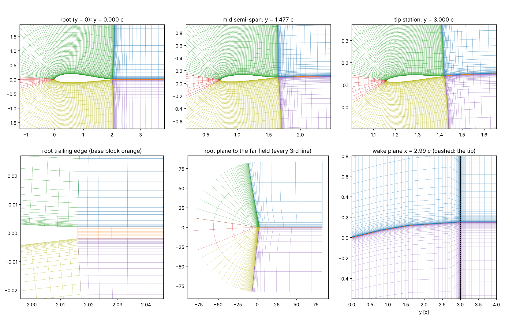
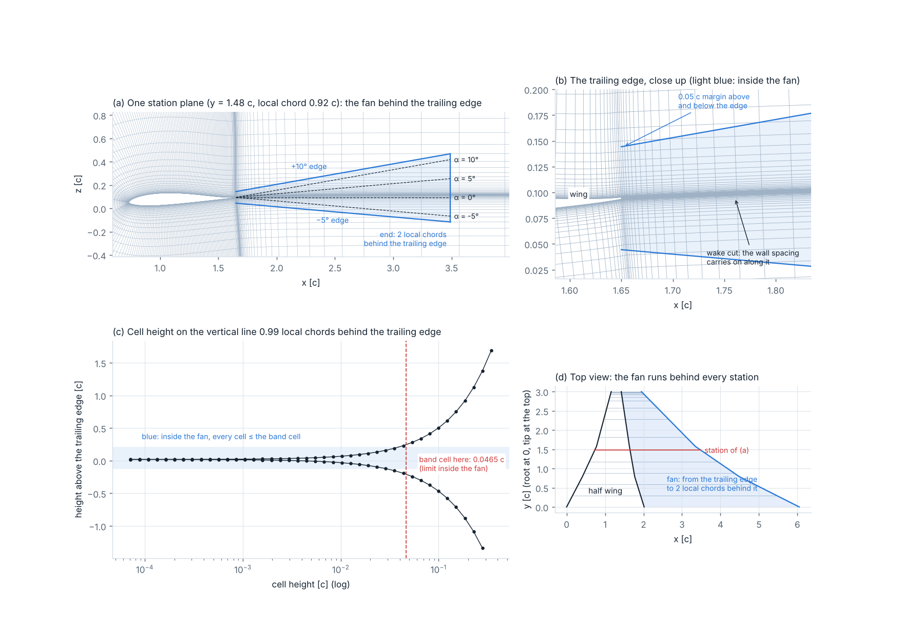
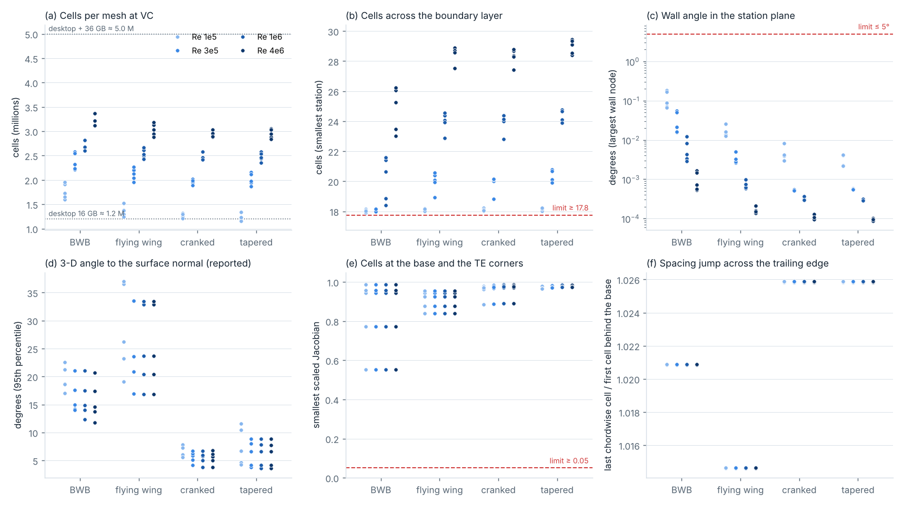
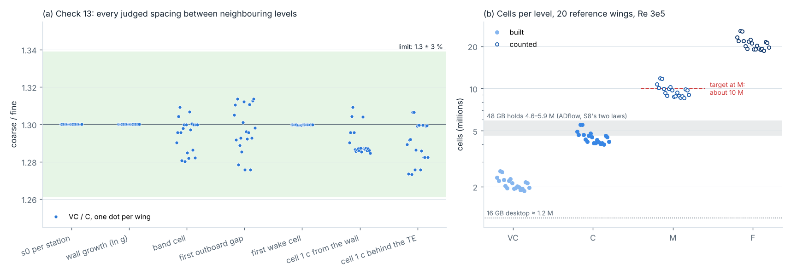
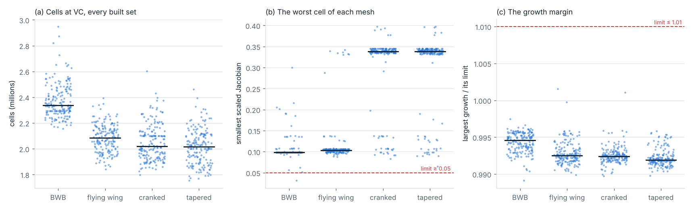

# Stage_3 — Executive summary: the volume mesh

10 Nov 2026 (02:00) · Michail Karalis · CFD_Automation, Stage 3 (repo karmix96/aeris, branch `stage3-volume-mesh`)

> **In brief.**
>
> - **Built:** one matched C-H volume mesh per wing, Re and level on the frozen Stage 2 surface (13 blocks; every wall
>   node a Stage 2 node), with structured CGNS for ADflow and `.su2` for SU2. 15 checks, written before any mesh was
>   judged; none changed.
> - **Two rule sets.** The first worked but cost too much: M 20.8 M cells, F 45 M. Mike, 9 Nov: cut it, M about 10 M
>   (decision 107), and the angles are −5° to +10° (decision 111). **Rule set 2: M 9.5 M cells, F 20.7 M** (medians,
>   the 20 reference wings at Re 3 × 10⁵).
> - **One mesh serves every angle from −5° to +10°.** A fixed fan of fine cells behind the trailing edge holds every
>   wake direction in that range. At +10° the fan costs no cells; to +20° it cost 11–14 %.
> - **Passes (rule set 2):** the 20 reference wings × 4 Re at VC (80 of 80); the family VC and C (40 of 40; check 13:
>   every spacing 1.3 within 3 %, worst 2.0 %); every built set at VC: 721 of 722 meshes pass (1 refused: BWB corner2 6, cell quality 0.032); the focus set 400 of 400.
> - **Three faults found and fixed on the way** (decisions 108–110), all in how the mesh is built, none in a limit:
>   the fan sized from the wake line instead of the trailing edge; the band limit taken at a cell's start; far cells
>   sheared between very close stations (fixed except on the most extreme corner wing).
> - **Memory (the open one):** the plan assumed 10 M cells in 48 GB. By S8's laws for ADflow, 48 GB holds 4.6–5.9 M:
>   VC and C fit, M (72–92 GiB) and F do not. Mike: keep the mesh; the first solves measure the real memory
>   (decision 113).
> - **Not done:** the first solves (V7: scripts and runbook ready; no solver here) and the hold-outs (V8: Mike's OK).

*What it shows.* BWB reference wing 0 at VC, Re 3 × 10⁵, rule set 2: the station planes at the root, mid semi-span
and tip; the root's trailing edge close up; the root plane out to the far field; the wake behind the wing in the y–z
plane.

**Conclusion.** One C per station, square to the wall, with the wake fan behind the trailing edge and the outboard
planes past the tip. 2,324,016 cells; every check passes.

## 1. What Stage 3 is

- **In:** the Stage 2 surface of one wing at one Re and level. **Out:** one matched multiblock mesh: 13 blocks.
- **Each station plane** (y = const) holds a C around the ring and the wake, out to the far field (80 c): upper wake,
  upper side, nose, lower side, lower wake, base. The planes are stacked root to tip; past the tip the tip plane and the
  tip cap are swept out to 80 c.
- **One mesh for both solvers** (decision 73): ADflow reads it as structured CGNS, SU2 as unstructured hexahedra.
- **Three outcomes:** passed; refused (only `refusal.json`); needs review (more smoothing was needed: never happened).

## 2. How one mesh is made

1. The C line: the wake lines and the Stage 2 ring. The wake line leaves the base along its normal, turns to +x.
2. The line shapes: one front from the C line, smoothed over its distance from the wall, out to 2 local chords; then
   straight to far-field nodes that every station shares.
3. The nodes: one wall-normal distribution per station: first cell s0 (y⁺ 1 at VC), the level's cells across the
   boundary layer (30 at M), growth ≤ 1.25 out to 2 local chords, the wake fan as an envelope in height, then the far
   growth. One count for all stations; each station's growth (never the band cell) is scaled down to fit it.
4. Far out, each station's layers and wake nodes move toward its neighbours', then toward the mean of all stations,
   so neighbouring planes line up. The near field is never moved.
5. The base block between the wake lines; the cap swept outboard.
6. 15 checks; the mesh is written only if it passes, with check 15 on the solver files.

## 3. The wake fan: one mesh for −5° to +10° (decision 111)

*What it shows.* BWB reference wing 0 at VC. (a) One station plane: the fan (blue) starts 0.05 c above and below the
trailing edge, its edges at −5° and +10°, its end 2 local chords behind; dashed: the freestream directions at −5°,
0°, 5° and 10°. (b) The trailing edge close up. (c) The cell height along the vertical line 1 local chord behind the
trailing edge; red: the band cell there. (d) Top view: the fan behind every station.

**Conclusion.** Every freestream direction from −5° to +10° lies inside the fan, and every cell inside it is no
larger than the band cell.

- **Why one mesh for all angles:** one mesh instead of about eight per wing and Re; the same mesh error at every
  angle, so the lift slope and the polar shape are clean; one family check per wing.
- **Why +10° and no more:** steady RANS serves −5° to +10° here. Post-stall is a separate study (decision 69) with its
  own mesh from the same code: the fan's two angles are inputs of the mesher.
- **No extra angle on top of the 0.05 c margin:** the downwash turns the wake below the freestream direction, and the
  cells do not jump at the fan's edge.

| Fan (cells counted at M, wing 0 of each type) | M cells, median | Against the fan to +20° |
| --- | --- | --- |
| −5° to +20° (the first choice, decision 87) | 10.5 M | |
| −5° to +15° | 9.8 M | −7 to −9 % |
| −5° to +12° | 9.3 M | −11 to −12 % |
| **−5° to +10° (decision 111)** | **9.0 M** | −11 to −14 % |
| A fan that follows one angle | 9.0 M | −11 to −14 % |
| No fan (the margin only) | 9.0 M | −11 to −14 % |

**Conclusion.** The fan to +20° paid 11–14 % of the cells for angles this mesh does not serve. At +10° the fan is
free, so a mesh per angle would save nothing more. Not measured: where the wake goes in a solution (V7 checks −5°
and +10°).

## 4. What was measured (rule set 2 as it stands)

| Step | What | Result |
| --- | --- | --- |
| V0 | the plane method on 501 planes; five boundary-layer laws | march: 0 folds (algebraic and elliptic: 501 of 501 folded); turbulent layer at the trailing edge |
| V1 | BWB reference wing 0, VC, Re 3 × 10⁵ | every check passes; 2.32 M cells (rule set 1: 4.93 M) |
| V2 | 20 reference wings × 4 Re at VC: wall layers, far field | 80 of 80 pass; cells across the boundary layer ≥ 17.92 (limit 17.75); growth ≤ 0.996 × its limit; in-plane angle ≤ 0.18° |
| V3 | the cap, the outboard blocks, the tip vortex | all pass; the cap is the worst part (0.062); the outboard blocks hold 41–46 % of the cells |
| V4 | the family VC, C, M, F | check 13 passes on 20 of 20 (worst 2.0 % off); M and F built on 4 wings: flying wing 0 at M: 9.20 M, passed; cranked 0 at M: 8.70 M, passed; tapered 0 at M: 8.77 M, passed; BWB 0 at M: 10.61 M, passed; BWB 0 at F: 23.10 M, passed |
| V5 | CGNS and `.su2` | read back exactly, also by the CGNS library; no inside-out cell |
| V6 | every other built set at VC | every built set at VC (702 wings) + the 20 reference wings: 721 of 722 pass; refused 1 (BWB corner2 6, cell quality 0.032); the focus set 400 of 400; M counted on 94 wings: 8.2–12.8 M (median 9.6 M) |
| V7 | first solves | written (case, ADflow run with the memory record, SU2 configs, acceptance rule, runbook); not run |

*What it shows.* One dot per mesh (20 wings × 4 Re at VC): cells; cells across the boundary layer; the in-plane wall
angle; the 3-D angle (reported); the cells at the base and the trailing-edge corners; the spacing jump across the
trailing edge.

**Conclusion.** The wall rules hold on every wing at every Re, and the spacing jump across the trailing-edge line is
gone (1.02–1.03; rule set 1: up to 537). Weak: the 3-D angle reaches 40° at swept noses (planar stations: square in
the plane, sheared in 3-D).

*What it shows.* (a) Every judged spacing, coarse over fine, between neighbouring levels (green: 1.3 ± 3 %). (b) Cells
per level on the 20 reference wings: VC and C built, M and F counted; the target at M; grey: what 48 GB holds.

**Conclusion.** The family is a true 1.3-scaled copy (20 of 20). M sits at the 10 M target. Only VC and C are under
the 48 GB band.

*What it shows.* Every screened mesh at VC, Re 3 × 10⁵, by wing type (the bar at the median): cells; the worst cell
of each mesh; the largest growth over its limit.

**Conclusion.** 721 of 722 meshes pass; 1 refused (BWB corner2 6, cell quality 0.032). The focus set, where most runs go, passes 400 of 400. In the screen: 3 of 722 meshes have their worst cell under 0.06, 1 under 0.05; the lowest: BWB corner2 6 0.032, BWB corner2 0 0.052, BWB full-space 31 0.056.

## 5. The cost and the memory (decisions 112, 113)

| Level | Cells, median (range) | ADflow RAM: ANK only · ANK then NK | Fits 48 GB? |
| --- | --- | --- | --- |
| VC | 2.08 M (1.87–2.58) | 18 · 21 GiB | yes |
| C | 4.43 M (3.99–5.54) | 35 · 43 GiB | yes (the largest only just) |
| M | 9.53 M (8.56–11.81) | 72 · 92 GiB | no |
| F | 20.7 M (18.7–25.7) | 152 · 197 GiB | no |

Counted on 94 wings of every set (a seeded 10 % of each set and type and the 20 reference wings, Re 3 × 10⁵): M 8.2–12.8 M (median 9.6 M), F 17.7–27.8 M (median 20.7 M).

- **Why so much per cell:** it is the solver, not the mesh (the mesh file is 59 MB for 2.3 M cells). ADflow's implicit
  solver keeps, per cell, the matrix to its 6 neighbours, a factored copy of it and its work vectors: about 1,000
  numbers per cell, so 7–10 GiB per million cells. The split is an estimate; the totals are S8's measurements.
- **The laws are weak here:** two-point fits at 0.57 and 1.11 M cells, extrapolated 8 × at M. ANK only (what runs
  here): 2.69 + 7.23 GiB per million cells. ANK then NK (what check 14 reports): 1.51 + 9.46.
- **The plan assumed 10 M cells in 48 GB.** The record says about 5 M (Stage 2: "+36 GB about 5.0 M cells; F needs the
  HPC"). When Mike set "M about 10 M", the package table showed the RAM at VC only: that was the gap.
- **Decided (Mike, decision 113):** keep the mesh. VC and C on the desktop, M and F on the HPC. V7 measures the real
  memory: ADflow as run, ADflow with a leaner preconditioner, SU2. Not chosen: cutting M to 5–6 M now (it needs the
  surface band off and the tip cap not wall-resolved).

**Conclusion.** Rule set 2 meets the cell target Mike set (M about 10 M) at 0.46 × the first rule set. It does not
make M fit 48 GB: by today's laws only VC and C do. Whether that holds is a measurement, and V7 makes it.

## 6. What the first builds of rule set 2 found (decisions 108–110)

| Decision | What failed | Cause | Fix (how the mesh is built) |
| --- | --- | --- | --- |
| 108 | check 11 on 9 of the first 13 full-space wings (band cells up to 1.07 × the band cell) | the fan is straight from the base, but the mesh's wake line falls up to 0.12 c behind a BWB centre body; the cells were sized from the wake line | the exact envelope of the straight fan around the bent line, per station |
| 109 | check 13 on 11 of 20 reference wings (ratios 1.247–1.285; limit 1.3 ± 3 %) | each cell took the band limit at its start, so the coarser level lagged more | each cell takes the limit at its own centre |
| 110 | check 3 on 6 full-space BWB wings over three versions of the fix (0.024–0.050; limit 0.05) | stations 0.0001–0.05 c apart whose far nodes sat far apart (the near field is sized in local chords) | the far part of each station moves toward its neighbours' average, as far as its growth limit allows, neighbours alike, with the ramp that leaves the least shear; the near part is never moved. After: 0.052–0.093; BWB corner2 6 stays refused (0.032) |

**Conclusion.** The three faults were in the construction, not in the rules; one was an incomplete fix of mine
(decision 106), and decision 110 took three versions, each found by a screen. No limit changed. In the screen: 3 of 722 meshes have their worst cell under 0.06, 1 under 0.05; the lowest: BWB corner2 6 0.032, BWB corner2 0 0.052, BWB full-space 31 0.056.

## 7. The first rule set (the record)

- V2 80 of 80; V4 check 13 on 20 of 20; V6 stopped at 427 of 702 wings when Mike decided the cells must drop
  (decision 105): the focus set 400 of 400, 20 full-space wings refused by the wake band (the fault of decision 108).
- Cells (medians): VC 4.55 M, C 9.73 M, M 20.8 M, F 45.4 M. Where they were (BWB 0, VC): 36,000 per station plane ×
  136 planes; the blocks past the tip held 54 %.

Packages counted for decision 105 (the 20 reference wings, Re 3 × 10⁵, median cells, the fan still to +20°):

| Package | Reopens | VC | C | M | F |
| --- | --- | --- | --- | --- | --- |
| **P0** rule set 1 | — | 4.55 M | 9.77 M | 20.79 M | 45.35 M |
| **P1** lighter volume rules | outboard growth, 30 boundary-layer cells at M, base y⁺ | 3.03 M | 6.44 M | 13.70 M | 29.71 M |
| **P2** P1 + a coarser wake band (**rule set 2**) | + the wake band | 2.45 M | 5.23 M | 11.09 M | 24.18 M |
| **P3** P2 + the tip cap not wall-resolved | + the frozen surface (tip gap) | 2.13 M | 4.51 M | 9.56 M | 20.74 M |
| **P4** P2 + the surface band off | + decision 81 | 1.68 M | 3.53 M | 7.51 M | 16.28 M |
| **P5** P2 + both Stage 2 changes | + both | 1.45 M | 3.06 M | 6.43 M | 13.99 M |
| **P6** P5 + far field 40 c + 30 boundary-layer cells at F | + the far field | 1.31 M | 2.76 M | 5.79 M | 12.54 M |

**Conclusion.** Mike chose P2 (the volume rules alone). The fan to +10° then took another 14 %: M 11.1 M → 9.5 M.
Going under about 6 M at M needs the Stage 2 changes (P4–P6).

## 8. Weak points

- **No solve yet** on a Stage 3 mesh: the memory at these sizes and where the wake goes are not measured.
- **Memory:** M needs 72–92 GiB for ADflow by S8's laws; 48 GB holds VC and C only.
- **The fan ends at +10°:** above it the wake leaves the fine cells (post-stall: its own mesh).
- **Very close stations with fast-changing chords** (steep BWB centre bodies, corner wings) sit nearest the
  cell-quality limit (decision 110); one corner wing is refused (BWB corner2 6: 0.032).
- **Coarser than rule set 1:** 1.25° per fan cell at M (was 0.63°); the tip vortex in cells 1.2–1.7 × larger across
  its path; 18–29 cells across the boundary layer at VC (30 at M); the base not at y⁺ 1.
- **Planar stations:** sheared in 3-D at swept noses: up to 40° on the reference wings, 74° on the most swept
  corner wing (reported, no limit; y⁺ only falls).
- **The cap's two nose-corner columns:** exempt (decision 101), not fixed.
- **C** built only on the reference wings, **M** on four, **F** on one (time on 2 cores, not memory).
- **The CGNS library check** used VTK's copy of CGNS, not Mike's 4.5.2 build.

## 9. Handover to Stage 4

- Per wing, Re and level: `volume_<level>_<hash8>_re<Re>/` with `blocks.npz`, `quality.json`, `manifest.json`,
  `volume.cgns`, `volume.su2` (a refused mesh: only `refusal.json`).
- `build_volume(surface)`, `write(vm, wing, out, formats=("npz", "cgns", "su2"))`; cost first: `count_volume(surface)`.
- First: V7 on Mike's machine (`solve/RUNBOOK.md`): the three solves, the memory, the wake at −5° and +10°. Then the
  hold-outs once with the rules frozen (V8), when Mike says so.
- The semi-span runs along +y, lift is +z (ADflow liftIndex 3); lengths in mean chords; Re on the mean chord; the band
  on; angles −5° to +10° on this mesh.

More: the page *Volume Mesh* (`docs/VOLUME_MESH.html`), `decisions/volume_rules.md`, `decisions/STAGE3_STATUS.md`.
